<div align="center">

# ⚙️ Jalur Latihan P5: Driver CAN untuk Motor Xiaomi CyberGear

**Persiapan hands-on Penugasan P5 (Electrical Internship Abinara-1) di STM32F103C8T6**


</div>

> [!NOTE]
> Ini **modul belajar**, bukan kunci jawaban. Tiap level mengajarkan satu kemampuan kecil lewat konsep, hitungan, latihan, dan uji otomatis. Sebagian besar latihan bisa dikerjakan **di laptop dengan `gcc`, tanpa hardware**, sehingga kamu bisa berlatih kapan saja. Hardware dipakai setelah logikanya terbukti benar.

## 🎯 Apa yang diminta P5

| # | Penugasan | Dilatih di |
|--:|---|---|
| 1a | Tambahkan fungsi yang belum ada di library `cyber_gear_driver` | Level 9, 10 |
| 1b | Decode data dari motor (temperature, fault, ...) | Level 7, 11 |
| 2 | Ubah library function-base menjadi **OOP** (poin plus) | Level 14 |
| 3 | Buat library **baremetal** (poin A+) | Level 15 |
| Demo 1–2 | Jelaskan kode, perubahan, dan alasannya | Level 9, 16 |
| Demo 3 | Test case dari penguji | Level 13 |
| Demo 4 | Kontrol **dua motor** dalam satu bus | Level 12 |
| Demo 5 | Temukan **CAN ID motor yang tidak diketahui** | Level 12 |

> [!IMPORTANT]
> Pada dokumen penugasan tertulis: *"AI tidak dilarang. Semua yang kamu kerjakan harus bisa dipertanggungjawabkan."* Itu artinya kamu harus bisa menjelaskan **setiap baris** dan menjawab "kenapa". Seluruh jalur latihan ini dirancang untuk itu: kamu menulis sendiri bagian-bagian intinya dan membuktikannya dengan uji.

## 🗺️ Peta belajar

```mermaid
flowchart LR
    subgraph A["A. Fondasi C (laptop)"]
        L0["0 Peta tugas"] --> L1["1 Bitwise"] --> L2["2 Extended ID"] --> L3["3 Endianness"] --> L4["4 Skala float"] --> L5["5 struct dan pointer"]
    end
    subgraph B["B. CAN dan protokol"]
        L6["6 CAN bus"] --> L7["7 Protokol dan decode"]
    end
    subgraph C["C. Hardware dan library"]
        L8["8 Bring-up CAN"] --> L9["9 Baca library"] --> L10["10 Tambah fungsi"] --> L11["11 Decode di library"]
    end
    subgraph D["D. Demo"]
        L12["12 Dua motor dan scan ID"] --> L13["13 Mode dan test case"]
    end
    subgraph E["E. Plus"]
        L14["14 OOP C++"]
        L15["15 Baremetal"]
    end
    L16["16 Persiapan demo"]
    L5 --> L6
    L7 --> L8
    L11 --> L12
    L13 --> L14 --> L15 --> L16
    L13 --> L16
```



| Level | Topik | Hardware? | Uji otomatis | Waktu* |
|---:|---|:-:|---|---|
| 0 | [Peta tugas dan setup](docs/00-peta-tugas.md) | tidak | | 1 jam |
| 1 | [Biner, heksadesimal, bitwise](docs/01-bitwise.md) | tidak | `make test-01` | 2 jam |
| 2 | [Masking dan Extended ID](docs/02-extended-id.md) | tidak | `make test-02` | 2 jam |
| 3 | [Tipe data, array, endianness](docs/03-endianness.md) | tidak | `make test-03` | 2 jam |
| 4 | [Skala float ↔ 16 bit](docs/04-skala-float.md) | tidak | `make test-04` | 2 jam |
| 5 | [struct, pointer, enum, NULL](docs/05-struct-pointer.md) | tidak | `make test-05` | 3 jam |
| 6 | [CAN bus: fisik, frame, timing](docs/06-can-bus.md) | tidak | | 2 jam |
| 7 | [Protokol CyberGear dan decode](docs/07-protokol-decode.md) | tidak | `make test-07` | 3 jam |
| 8 | [Bring-up hardware dan loopback](docs/08-bringup-can.md) | ya | | 3 jam |
| 9 | [Membaca library yang diberikan](docs/09-baca-library.md) | opsional | | 2 jam |
| 10 | [Melengkapi library: perintah](docs/10-tambah-fungsi.md) | tidak | `make test-10` | 3 jam |
| 11 | [Decode data motor di library](docs/11-decode-di-library.md) | ya | | 3 jam |
| 12 | [Dua motor dan mencari CAN ID](docs/12-dua-motor-scan.md) | ya | `make test-12` | 3 jam |
| 13 | [Mode kontrol dan test case](docs/13-mode-test-case.md) | ya | | 3 jam |
| 14 | [OOP dengan C++](docs/14-oop.md) | tidak | `make test-14` | 4 jam |
| 15 | [Library baremetal bxCAN](docs/15-baremetal.md) | ya | `make test-15` | 5 jam |
| 16 | [Persiapan demo](docs/16-persiapan-demo.md) | ya | | 2 jam |

\*Perkiraan kasar untuk pemula. Lebih baik lambat tapi paham.

> [!TIP]
> **Jalur minimum** kalau waktu mepet: Level 0 → 1 → 2 → 3 → 4 → 7 → 8 → 9 → 10 → 11 → 12 → 16. Level 5 dan 6 membantu memahami kodenya, dan Level 13 sampai 15 adalah nilai plus.

## 🔁 Cara belajar di tiap level

1. **Baca konsep** tanpa menyentuh keyboard.
2. **Tebak hasilnya** sebelum menjalankan. Salah menebak adalah cara belajar tercepat.
3. **Kerjakan latihan** berurutan. Untuk latihan di laptop: `cd exercises && make test-XX`. Awalnya semua uji **GAGAL**; targetmu membuatnya `PASS`.
4. **Aturan 15 menit:** buka `▶ Petunjuk` hanya setelah mencoba sendiri 15 menit. Petunjuknya bertingkat.
5. **Cek pemahaman** di akhir level. Tulis jawabanmu dulu, baru buka kunci.
6. **Commit** (`git commit -m "level-04: float_to_uint lolos uji"`).

## 🧰 Alat dan bahan

| Kebutuhan | Untuk | Catatan |
|---|---|---|
| Laptop + `gcc`, `g++`, `make` | Level 1–7, 10, 12, 14, 15 (uji) | Ubuntu: `sudo apt install build-essential` |
| STM32CubeIDE + ST-Link | Level 8, 11–13, 15 (hardware) | project `ELC_FW_MAGANG_P5_LITE` |
| Blue Pill STM32F103C8T6 | Level 8+ | |
| **CAN transceiver** (SN65HVD230 3,3 V, atau TJA1050/MCP2551 dengan perhatian level logika) | Level 8+ | MCU tidak bisa langsung ke bus |
| Motor Xiaomi CyberGear (1–2 buah) | Level 8, 11–13 | |
| Catu daya **24 V** dengan **pembatas arus** | Level 8+ | motor 16–28 V; jangan lewat USB |
| Resistor 120 Ω ×2, kabel twisted-pair, konektor XT30(2+2) | Level 8+ | |
| Multimeter | Level 8 | cek terminasi dan tegangan |

> [!CAUTION]
> Motor ini kuat (torsi puncak 12 N·m) dan bisa menarik arus puncak 23 A. **Selalu jepit motor**, jauhkan tangan dan kabel dari poros, siapkan saklar daya yang mudah dijangkau, dan mulai dari torsi/Kp kecil. Aturan lengkap ada di [Level 8](docs/08-bringup-can.md#2-checklist-keselamatan-wajib-dibaca).

## 📁 Struktur repositori

```text
.
├── README.md
├── docs/                 ← satu file per level + cheatsheet + troubleshooting
├── exercises/            ← kerangka kode, uji otomatis, Makefile (jalankan di laptop)
│   ├── common/           ← cg_defs.h: konstanta dan struct CgFrame
│   └── level-XX-.../     ← file dengan TODO yang kamu isi
├── assets/               ← gambar penjelas
└── .github/ISSUE_TEMPLATE/
```

## ✅ Pelacak progres

- [ ] Level 0: tahu apa yang diminta dan sudah membaca library yang diberikan
- [ ] Level 1: `make test-01` lolos
- [ ] Level 2: `make test-02` lolos, bisa membongkar ID dengan tangan
- [ ] Level 3: `make test-03` lolos, bisa menjelaskan big vs little-endian
- [ ] Level 4: `make test-04` lolos, bisa menghitung resolusi
- [ ] Level 5: `make test-05` lolos, paham `->` dan pointer
- [ ] Level 6: bisa menjelaskan CAN dan menghitung bit timing 1 Mbps
- [ ] Level 7: `make test-07` lolos
- [ ] Level 8: frame loopback terkirim dan diterima; bus nyata terpasang aman
- [ ] Level 9: daftar celah library sudah kamu temukan sendiri
- [ ] Level 10: `make test-10` lolos, fungsi baru masuk ke library
- [ ] Level 11: temperature dan fault terbaca dari motor nyata
- [ ] Level 12: dua motor bergerak; `make test-12` lolos; scan ID bekerja di bus nyata
- [ ] Level 13: mode kecepatan/posisi dan skenario test case jalan
- [ ] Level 14: `make test-14` lolos; library versi class berjalan
- [ ] Level 15: `make test-15` lolos; CAN jalan tanpa HAL
- [ ] Level 16: sudah latihan menjawab pertanyaan demo

## 🐙 Memakai fitur GitHub

```bash
git init && git add . && git commit -m "init: jalur latihan P5"
git tag level-04-done          # titik aman per level
```

Satu **Issue** per level memakai template *Level checklist*, lalu tarik ke **Project board** (Belum, Sedang, Selesai). Tempel keluaran `make test-XX` di komentar Issue sebagai bukti progres.

## 📚 Rujukan

- *P5 CyberGear Implementation* (modul: bitwise, pemrograman C, CAN bus)
- *Modul 3 OOP C++*
- `PENUGASAN_P5_2026.pdf`
- Xiaomi CyberGear instruction manual (repositori `cybergear-docs`)
- RM0008 (Reference Manual STM32F1), bab bxCAN

**Mulai →** [Level 0: Peta tugas dan setup](docs/00-peta-tugas.md)
