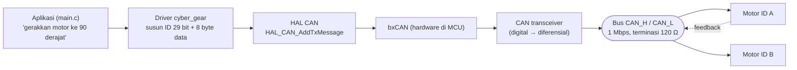

# Level 0: Peta Tugas dan Setup

[← Beranda](../README.md) · [Level 1: Bitwise →](01-bitwise.md)

> [!NOTE]
> Tujuan level ini: tahu **persis apa yang diminta**, memahami gambaran besar sistemnya, dan memastikan alat uji di laptopmu berfungsi.

## Tujuan belajar

- [ ] Menjelaskan alur data dari kode sampai ke motor
- [ ] Membedakan lapisan aplikasi, driver, HAL, dan hardware
- [ ] Menjalankan `make` dan membaca hasil uji
- [ ] Mengetahui mana yang sudah ada di library dan mana yang belum

---

## 🧠 Konsep

### 1. Gambaran besar

Kamu akan membuat **driver**: kode yang menerjemahkan niat ("putar motor 34 ke 90°") menjadi frame CAN yang dimengerti motor, dan menerjemahkan frame balasan menjadi angka yang bisa dibaca ("suhu 35,5 °C").



| Lapisan | Tugasnya | Di P5 |
|---|---|---|
| Aplikasi | Memutuskan *apa* yang dilakukan | `main.c` |
| **Driver** | Mengubah niat ↔ frame CAN | **`cyber_gear.c/.h` (inti P5)** |
| HAL | Memanggil register bxCAN lewat fungsi | `HAL_CAN_*` (diberikan) |
| bxCAN | Pengendali CAN di dalam MCU | hardware |
| Transceiver | Menjadi level tegangan diferensial | modul eksternal |

Pada **Level 15 (baremetal)**, lapisan HAL dibuang: driver langsung menulis register bxCAN.

### 2. Arsitektur yang akan kita bangun

Pola yang sangat membantu: pisahkan **logika protokol** (murni, hanya angka) dari **transport** (HAL).

| Bagian | Sifat | Bisa diuji di laptop? |
|---|---|---|
| Protokol (susun ID, skala float, decode) | murni C, tanpa HAL | **ya** |
| Transport (kirim/terima frame) | memanggil HAL atau register | hanya dengan mock |
| Aplikasi | merangkai keduanya | sebagian |

Itulah sebabnya Level 1–7, 10, 12 bisa dikerjakan di laptop. Setelah logika terbukti benar lewat uji, barulah kita pasang ke HAL.

### 3. Isi project yang diberikan (gambaran awal)

Dari `ELC_FW_MAGANG_P5_LITE.zip`, bagian yang relevan ada di `Core/cyber_gear_driver/` (`cyber_gear.h`, `cyber_gear.c`) dan `Core/Src/main.c`. Detail pembacaannya baru di [Level 9](09-baca-library.md). Untuk sekarang cukup lakukan latihan 0B di bawah.

---

## 🧪 Latihan

### 0A. Siapkan laptop

```bash
# Ubuntu / Debian
sudo apt install build-essential git

cd exercises
make help
make test-01      # akan GAGAL semua, itu normal
```

**Hasil yang diharapkan:** daftar `FAIL ...` dan baris `ADA YANG GAGAL (23 gagal)`. Itu titik awalmu. Targetmu adalah membuatnya menjadi `SEMUA LOLOS`.

### 0B. Inventaris library (awal)

Ekstrak `ELC_FW_MAGANG_P5_LITE.zip`, lalu di folder `Core/cyber_gear_driver/` jalankan:

```bash
grep -n "cybergear_" cyber_gear.h        # fungsi yang DIDEKLARASIKAN
grep -n "^[a-zA-Z].*cybergear_.*(" cyber_gear.c   # fungsi yang DIDEFINISIKAN
```

Buat tabel dua kolom: *di header* vs *di .c*. Apakah ada yang muncul di satu sisi saja? Catat; kamu akan memakainya di Level 9.

<details>
<summary>▶ Petunjuk</summary>

Fungsi yang dideklarasikan di `.h` tetapi tidak ada isinya di `.c` akan menyebabkan error *undefined reference* hanya saat fungsinya **dipanggil**. Itu sebabnya celah seperti ini bisa tidak terlihat sampai ada yang memakainya.

</details>

### 0C. Gambar sendiri

Di kertas, gambar diagram blok seperti di atas, tetapi **dengan dua motor** dan beri label pada tiap kabel (TX, RX, CAN_H, CAN_L, 24 V, GND). Jangan menyalin; gambar dari ingatan. Kamu akan membandingkannya dengan gambar yang benar di Level 8.

### 0D. Kamus istilah

Tulis arti satu kalimat untuk: *node, frame, identifier, payload, arbitrasi, terminasi, transceiver, feedback, baud rate*. Cek jawabanmu setelah Level 6.

---

## ✅ Checkpoint: lulus jika

- [ ] `make test-01` berjalan (gagal itu wajar) dan kamu bisa membaca hasilnya
- [ ] Kamu bisa menjelaskan kenapa protokol dipisah dari transport
- [ ] Tabel 0B terisi

## ❓ Cek pemahaman

**1.** Kenapa transceiver CAN dibutuhkan, tidak cukup menyambung pin MCU ke bus?

**2.** Bagian mana dari sistem yang bisa diuji tanpa hardware, dan kenapa?

**3.** Pada layer apa pekerjaan P5 terutama berada?

<details>
<summary>▶ Kunci jawaban (tulis jawabanmu dulu)</summary>

1. MCU hanya menghasilkan level logika 0/3,3 V pada TX/RX. Bus CAN memakai sinyal **diferensial** CAN_H/CAN_L; transceiver yang mengubah keduanya.
2. Logika protokol (susun ID, skala angka, decode), karena hanya operasi angka dan tidak memanggil register hardware.
3. Lapisan **driver** (`cyber_gear.c/.h`): menyusun frame dan men-decode balasan.

</details>

---

[← Beranda](../README.md) · [Level 1: Bitwise →](01-bitwise.md)
