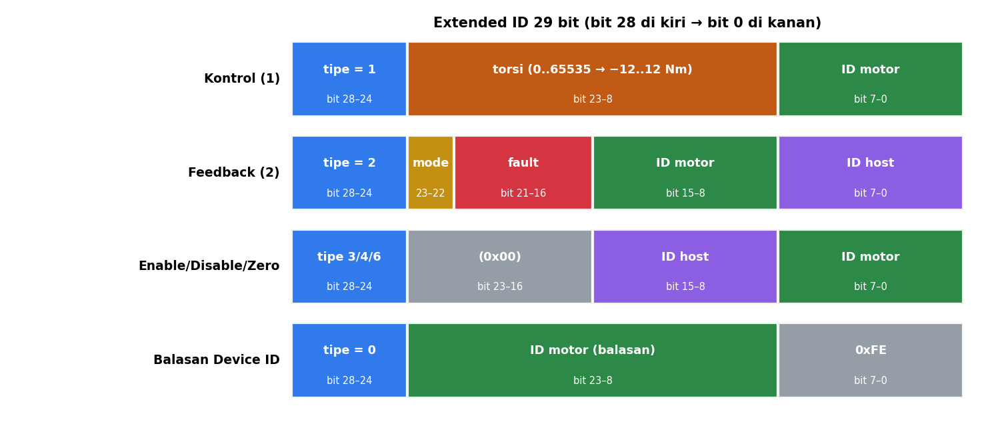

# Level 2: Masking dan Extended ID 29 Bit

[← Level 1](01-bitwise.md) · [Beranda](../README.md) · [Level 3: Endianness →](03-endianness.md)

> [!NOTE]
> Tujuan level ini: membaca dan menyusun **Extended ID** CAN. Di CyberGear, ID 29 bit tidak sekadar "alamat". ID itu membawa **tipe perintah, ID motor, ID host, bahkan nilai torsi, mode, dan fault**.

## Tujuan belajar

- [ ] Menjelaskan kenapa CyberGear memakai Extended Frame
- [ ] Menyusun (pack) dan membongkar (unpack) ID 29 bit
- [ ] Menghafal peta field untuk perintah dan feedback
- [ ] Membaca ID mentah dan langsung tahu artinya

**Prasyarat:** [Level 1](01-bitwise.md). Folder: `exercises/level-02-can-id/`.

---

## 🧠 Konsep

### 1. Standard vs Extended

Dari modul CAN bus: **Standard frame** memakai ID 11 bit, **Extended frame** memakai ID **29 bit**. CyberGear memakai Extended, karena 29 bit cukup luas untuk memuat beberapa field sekaligus di dalam ID.

### 2. Peta field



Semua frame berbagi bentuk dasar: **tipe (5 bit) di atas, data area 2 (16 bit) di tengah, target (8 bit) di bawah.** Isi "data area 2" berbeda-beda per tipe:

| Tipe (hex) | Nama | data area 2 (bit 23..8) | target (bit 7..0) |
|---:|---|---|---|
| `0x00` | Get Device ID | ID host (di bit 15..8) | ID motor |
| `0x01` | Kontrol operasi (MIT) | **nilai torsi 16 bit** | ID motor |
| `0x02` | Feedback (motor → host) | mode (23..22), fault (21..16), ID motor (15..8) | ID host |
| `0x03` | Enable | ID host | ID motor |
| `0x04` | Disable / clear fault | ID host | ID motor |
| `0x06` | Set zero | ID host | ID motor |
| `0x07` | Set CAN ID | ID baru (23..16) + ID host (15..8) | ID motor |
| `0x11` | Baca parameter | ID host | ID motor |
| `0x12` | Tulis parameter | ID host | ID motor |
| `0x15` | Laporan fault | (lihat manual) | |

Sedangkan balasan Get Device ID (tipe 0) dari motor berbentuk: tipe 0, ID motor di data area 2, target `0xFE`.

### 3. Pack dan unpack

Dari modul (Bab 1.2):

```c
// PACK: letakkan nilai ke posisinya, lalu gabungkan dengan OR
uint32_t id = ((uint32_t)type << 24) | ((uint32_t)data << 8) | target;

// UNPACK: geser field ke posisi 0, lalu buang sisanya dengan AND
uint8_t type   = (id >> 24) & 0x1F;   // 5 bit
uint8_t motor  = (id >>  8) & 0xFF;   // 8 bit
uint8_t target =  id        & 0xFF;   // 8 bit
```

**Contoh hitungan:** Enable motor 34 (`0x22`) dari host 253 (`0xFD`):

| Langkah | Nilai |
|---|---|
| `type << 24` | `3 << 24 = 0x03000000` |
| `data2 << 8` | `0x00FD << 8 = 0x0000FD00` |
| `target` | `0x00000022` |
| **OR semuanya** | **`0x0300FD22`** |

> [!IMPORTANT]
> Cast `(uint32_t)` **sebelum** menggeser. `type` bertipe 8 bit; menggesernya 24 posisi tanpa cast bisa memberi hasil salah atau perilaku tak terdefinisi pada tipe yang lebih kecil dari `int`.

### 4. Kenapa tipe diletakkan di bit teratas?

Dua node yang mengirim bersamaan akan bertarung di **arbitrasi**: bit dikirim dari yang tertinggi; bit **dominant (0) mengalahkan recessive (1)**. Akibatnya **ID yang nilainya lebih kecil menang**. Dengan tipe di bit teratas, tipe bernomor kecil (misalnya 0 dan 1) otomatis lebih prioritas daripada tipe besar. Itu desain yang disengaja.

---

## 🧪 Latihan

### 2A. Baca ID dengan tangan

Bongkar tujuh ID berikut menjadi field. Tulis tipe, dan arti field utamanya. Pakai peta di atas.

| # | ID | Tipe | Arti |
|:-:|---|---|---|
| A | `0x0300FD7F` | | |
| B | `0x028815FD` | | |
| C | `0x1200FD22` | | |
| D | `0x0740FD7F` | | |
| E | `0x026022FD` | | |
| F | `0x01800022` | | |
| G | `0x000012FE` | | |

<details>
<summary>▶ Kunci jawaban (cek setelah mencoba)</summary>

| # | Hasil |
|:-:|---|
| A | tipe 3 **Enable**; host `0xFD` = 253; motor `0x7F` = 127 |
| B | tipe 2 **Feedback**; mode 2 (RUN); fault `0b001000` = bit 19 (**magnetic encoder fault**); motor `0x15` = 21; host 253 |
| C | tipe `0x12` **tulis parameter**; host 253; motor 34 |
| D | tipe 7 **Set CAN ID**; ID baru `0x40` = 64; host 253; motor lama 127 |
| E | tipe 2 **Feedback**; mode 1 (kalibrasi); fault `0b100000` = bit 21 (**belum dikalibrasi**); motor 34; host 253 |
| F | tipe 1 **Kontrol**; torsi mentah `0x8000` (≈ 0 Nm); motor 34 |
| G | tipe 0 **balasan Get Device ID**; motor `0x12` = 18; target `0xFE` |

</details>

### 2B. Implementasi `cg_id.c`

Isi semua fungsi di `exercises/level-02-can-id/cg_id.c`. Pakai kembali ide `get_field` dari Level 1 (menyalin logikanya itu wajar).

```bash
cd exercises && make test-02
```

<details>
<summary>▶ Petunjuk 1: <code>cg_id_pack</code></summary>

Mask tipe dengan `0x1F` supaya tidak bocor ke bit 29 ke atas, lalu geser 24. `data2` digeser 8. `target` apa adanya. Gabungkan dengan `|`.

</details>

<details>
<summary>▶ Petunjuk 2: fungsi untuk feedback</summary>

mode = `(id >> 22) & 0x03`, fault = `(id >> 16) & 0x3F`, motor = `(id >> 8) & 0xFF`. Semuanya hanya variasi dari satu pola: **geser, lalu mask**.

</details>

### 2C. Tantangan opsional: `idtool`

Tulis program `idtool.c` yang menerima ID heksadesimal dari baris perintah dan mencetak semua field:

```bash
./idtool 0x028422FD
# type=2 mode=2 fault=000100 motor=34 host=253
```

Petunjuk: `strtoul(argv[1], NULL, 16)` mengubah teks hex menjadi angka. Alat kecil ini akan menghemat waktu saat men-debug frame mentah di Level 8 dan 11.

---

## ✅ Checkpoint: lulus jika

- [ ] `make test-02` menampilkan `SEMUA LOLOS`
- [ ] Tabel 2A benar tanpa melihat kunci
- [ ] Kamu bisa menjelaskan kenapa ID kecil lebih prioritas

## ❓ Cek pemahaman

**1.** Susun ID untuk "Disable motor 12 dari host 253".

**2.** ID `0x02800000 | (34 << 8) | 0xFD`: mode, motor, host?

**3.** Kenapa ID Extended bisa menampung nilai torsi untuk perintah kontrol?

**4.** Frame mana yang menang arbitrasi: tipe 1 (kontrol) atau tipe 2 (feedback)?

<details>
<summary>▶ Kunci jawaban (tulis jawabanmu dulu)</summary>

1. tipe 4, data2 = 253 (`0x00FD`), target 12 (`0x0C`): `0x0400FD0C`.
2. Hasil penjumlahannya `0x028022FD`. Tipe = 2 (feedback); bit 23 menyala dan bit 22 mati sehingga **mode = 2** (RUN); fault = 0; motor = 34; host = 253.
3. Format kontrol meletakkan torsi 16 bit di bit 23..8 ID (data area 2), sedangkan data frame membawa sudut, kecepatan, Kp, dan Kd.
4. Tipe 1 menang, karena ID-nya lebih kecil (`0x01...` < `0x02...`).

</details>

---

[← Level 1](01-bitwise.md) · [Beranda](../README.md) · [Level 3: Endianness →](03-endianness.md)
