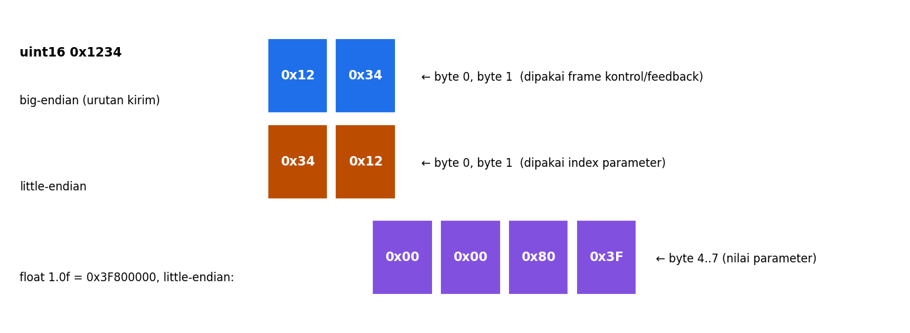

# Level 3: Tipe Data, Array, dan Endianness

[← Level 2](02-extended-id.md) · [Beranda](../README.md) · [Level 4: Skala Float →](04-skala-float.md)

> [!NOTE]
> Tujuan level ini: memahami **bagaimana angka disimpan sebagai byte**, dan **urutan byte yang dikirim**. Di protokol CyberGear ada dua urutan berbeda dalam satu frame, jadi ini area yang sering menjebak.

## Tujuan belajar

- [ ] Memilih tipe `stdint.h` yang tepat dan tahu rentangnya
- [ ] Memakai casting dengan benar
- [ ] Memakai array, `memset`, `memcpy` dengan aman
- [ ] Membedakan big-endian dan little-endian, dan tahu mana yang dipakai di tiap field

**Prasyarat:** [Level 1](01-bitwise.md). Folder: `exercises/level-03-payload/`.

---

## 🧠 Konsep

### 1. Tipe dengan ukuran pasti

Ukuran `int` bisa berbeda antar platform. Protokol CAN menetapkan jumlah bit yang tepat, jadi dipakai tipe dari `<stdint.h>`:

| Tipe | Ukuran | Rentang | Di kode CyberGear |
|---|---|---|---|
| `uint8_t` | 1 byte | 0..255 | ID motor, ID host |
| `uint16_t` | 2 byte | 0..65535 | posisi, kecepatan, torsi mentah |
| `uint32_t` | 4 byte | 0..4 294 967 295 | Extended ID |
| `float` | 4 byte | ≈ 7 digit akurat | posisi, kecepatan, Kp, Kd |
| `bool` | 1 byte | true/false | `is_error`, `is_updated` |

`u` artinya *unsigned* (tanpa nilai negatif). `bool` perlu `#include <stdbool.h>`.

### 2. Casting dan jebakan pembagian integer

```c
int a = 5, b = 2;
float c1 = (float)a / b;     // 2.5   (a diubah ke float dulu)
float c2 = (float)(a / b);   // 2.0   (dibagi sebagai integer dulu, baru diubah)
```

> [!WARNING]
> Pembagian dua integer **memotong pecahan**. `5 / 2` adalah `2`. Ini sumber bug klasik pada penskalaan sensor. Pastikan salah satu operandnya `float`.

### 3. Array dan batasnya

```c
uint8_t payload[8] = {0};   // 8 byte, semuanya 0
payload[0] = 0x12;          // elemen pertama (indeks 0)
payload[7] = 0xFF;          // elemen terakhir  (indeks 7)
```

Mengakses `payload[8]` **tidak error di kompilasi**, tetapi merusak memori lain. Frame CAN klasik maksimal **8 byte**, jadi indeks `0..7`.

`memset(buf, 0, sizeof buf)` mengisi seluruh blok dengan nilai; `memcpy(dst, src, n)` menyalin `n` byte (butuh `<string.h>`).

### 4. Endianness

Satu angka yang lebih dari 1 byte harus dipecah menjadi byte. **Urutannya** yang disebut endianness:

| Jenis | Aturan | `0x1234` menjadi |
|---|---|---|
| **Big-endian** | byte paling signifikan (MSB) duluan | `12 34` |
| **Little-endian** | byte paling tidak signifikan (LSB) duluan | `34 12` |



STM32F103 (ARM Cortex-M3) dan laptopmu (x86) sama-sama **little-endian** dalam menyimpan memori. Tetapi **protokol** boleh memilih urutan sendiri.

### 5. Dua urutan dalam satu protokol CyberGear

> [!IMPORTANT]
> Di CyberGear:
> - Frame **kontrol dan feedback** (sudut, kecepatan, torsi, Kp, Kd, suhu) memakai **big-endian**: byte tinggi di `data[0]`, byte rendah di `data[1]`.
> - **Index parameter** dan **nilai parameter** (frame tulis/baca parameter) memakai **little-endian**, karena manual menyalin variabel langsung dengan `memcpy` pada MCU little-endian.

| Field | Posisi | Urutan |
|---|---|---|
| Sudut target / kecepatan / Kp / Kd | data[0..7] (kontrol) | big-endian |
| Sudut / kecepatan / torsi / suhu (feedback) | data[0..7] | big-endian |
| Index parameter (mis. `0x7005`) | data[0..1] | **little-endian** → `05 70` |
| Nilai parameter float | data[4..7] | **little-endian** |
| Nilai fault 32 bit (tipe 21) | data[0..3] | *diasumsikan* little-endian (lihat Level 7) |

**Contoh:** index `0x7005` dikirim sebagai byte `05 70`. Jika salah urutan (`70 05`), motor membaca index `0x0570`, parameter yang berbeda atau tidak ada.

### 6. Float sebagai byte

`float` mengikuti standar IEEE-754. `1.0f` bit-nya adalah `0x3F800000`; `5.0f` adalah `0x40A00000`.

```c
uint32_t u;
memcpy(&u, &v, 4);        // salin BIT float ke integer (bukan mengubah nilainya!)
```

> [!CAUTION]
> `(uint32_t)v` **mengubah nilai** (1.0f menjadi 1). `memcpy` **menyalin bit** (1.0f menjadi `0x3F800000`). Untuk mengirim float sebagai byte, yang kamu butuhkan adalah `memcpy`.

Setelah jadi `uint32_t`, tulis tiap byte dari yang terendah: `5.0f` menjadi `00 00 A0 40`.

---

## 🧪 Latihan

### 3A. Lihat endianness di laptopmu

Tulis program kecil:

```c
#include <stdio.h>
#include <stdint.h>
int main(void) {
    uint32_t x = 0x12345678;
    uint8_t *p = (uint8_t *)&x;
    for (int i = 0; i < 4; i++) printf("byte %d = %02X\n", i, p[i]);
}
```

**Tebak dulu** urutannya, lalu jalankan. Apakah byte 0 bernilai `78` atau `12`? Apa artinya?

<details>
<summary>▶ Penjelasan</summary>

Pada mesin little-endian, `byte 0 = 78`: byte paling tidak signifikan disimpan di alamat terendah. Itu sebabnya `host_is_little_endian()` bisa dibuat dengan membaca byte pertama dari `uint16_t 0x0001`.

</details>

### 3B. Fungsi 16 bit

Isi di `payload.c`: `put_u16_be`, `get_u16_be`, `put_u16_le`, `get_u16_le`. Pola: pecah dengan `>> 8` dan `& 0xFF`; susun dengan `<< 8` dan `|`.

```bash
cd exercises && make test-03
```

<details>
<summary>▶ Petunjuk: <code>get_u16_be</code></summary>

`((uint16_t)buf[0] << 8) | buf[1]`. Cast ke `uint16_t` dulu supaya geser tidak kehilangan bit, dan karena `buf` bertipe `uint8_t` hasilnya tidak pernah negatif.

</details>

### 3C. 32 bit dan float

Isi `get_u32_le`, `put_f32_le`, `get_f32_le`, dan `host_is_little_endian`. Untuk float: `memcpy` ke `uint32_t`, lalu pecah per byte. Dengan menulis per byte, kodemu tidak bergantung pada endianness CPU.

### 3D. Pasangkan field dengan urutannya

Tanpa melihat tabel di atas, tulis di kertas: untuk tiap field (sudut kontrol, index parameter, nilai float parameter, suhu feedback), apakah BE atau LE? Cocokkan dengan tabel.

---

## ✅ Checkpoint: lulus jika

- [ ] `make test-03` menampilkan `SEMUA LOLOS`
- [ ] Kamu bisa menjelaskan kenapa index `0x7005` dikirim sebagai `05 70`
- [ ] Kamu bisa menjelaskan beda `(uint32_t)v` dan `memcpy` untuk float

## ❓ Cek pemahaman

**1.** Tulis byte-byte untuk `0x05DC` secara BE dan LE.

**2.** `a = 7`, `b = 2`. Berapa `(float)a / b` dan `(float)(a / b)`?

**3.** Berapa byte data[0..7] untuk menulis parameter `0x700A` bernilai `5.0f`?

**4.** Kenapa `payload[8]` pada array 8 elemen berbahaya?

<details>
<summary>▶ Kunci jawaban (tulis jawabanmu dulu)</summary>

1. BE: `05 DC`; LE: `DC 05`. (1500 = 0x05DC)
2. `3.5` dan `3.0`.
3. index LE `0A 70`, byte 2 dan 3 nol, lalu `5.0f` LE `00 00 A0 40`: `0A 70 00 00 00 00 A0 40`.
4. Indeks valid hanya 0..7; indeks 8 menulis di luar array dan merusak memori lain tanpa peringatan kompiler.

</details>

---

[← Level 2](02-extended-id.md) · [Beranda](../README.md) · [Level 4: Skala Float →](04-skala-float.md)
