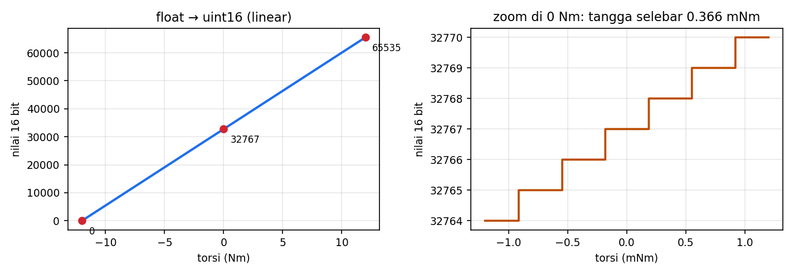

# Level 4: Skala Float ↔ Angka 16 Bit

[← Level 3](03-endianness.md) · [Beranda](../README.md) · [Level 5: struct dan pointer →](05-struct-pointer.md)

> [!NOTE]
> Tujuan level ini: memahami bagaimana nilai fisik (radian, rad/s, Nm, Kp, Kd) **dipadatkan menjadi 16 bit** untuk frame CAN, dan sebaliknya. Ini juga bagian yang paling mungkin ditanyakan saat demo ("kenapa rumusnya begitu?").

## Tujuan belajar

- [ ] Menurunkan rumus interpolasi linear sendiri
- [ ] Menghitung resolusi (selisih terkecil yang bisa dikodekan)
- [ ] Menjelaskan kenapa nilai harus di-*clamp*
- [ ] Mengimplementasikan `float_to_uint` dan `uint_to_float`

**Prasyarat:** [Level 3](03-endianness.md). Folder: `exercises/level-04-scaling/`.

---

## 🧠 Konsep

### 1. Masalahnya

Frame CAN hanya membawa 8 byte. Posisi, kecepatan, torsi, Kp, dan Kd masing-masing hanya mendapat **16 bit** (0..65535). Padahal nilai aslinya pecahan dengan rentang berbeda-beda.

Solusinya: **petakan rentang fisik ke rentang 0..65535 secara linear.**

| Besaran | Rentang fisik | Dipetakan ke |
|---|---|---|
| Posisi | −4π .. +4π rad | 0 .. 65535 |
| Kecepatan | −30 .. +30 rad/s | 0 .. 65535 |
| Torsi | −12 .. +12 Nm | 0 .. 65535 |
| Kp | 0 .. 500 | 0 .. 65535 |
| Kd | 0 .. 5 | 0 .. 65535 |

### 2. Menurunkan rumus

Ujung bawah rentang (`min`) harus menjadi 0 dan ujung atas (`max`) menjadi 65535. Posisi di dalam rentang dinyatakan sebagai **pecahan**:

$$ \text{pecahan} = \frac{val - min}{max - min} \qquad (0 \text{ sampai } 1) $$

Kalikan dengan 65535 untuk mendapatkan angka 16 bit:

$$ raw = \frac{(val - min) \times 65535}{max - min} $$

Arah sebaliknya (membalik persamaan):

$$ val = \frac{raw \times (max - min)}{65535} + min $$

Kenapa **65535**, bukan 65536? Karena 16 bit punya 65536 nilai (0 sampai 65535) tetapi hanya **65535 celah** di antaranya; supaya `min → 0` dan `max → 65535` pas di kedua ujung, pembaginya 65535.

### 3. Contoh hitungan lengkap

**Torsi 0 Nm** pada rentang −12..12:

$$ raw = \frac{(0 + 12) \times 65535}{24} = 32767{,}5 \;\Rightarrow\; 32767 \text{ (dipotong)} $$

**Posisi π rad** pada rentang −4π..4π:

$$ raw = \frac{(\pi + 4\pi) \times 65535}{8\pi} = \frac{5}{8} \times 65535 = 40959{,}375 \;\Rightarrow\; 40959 $$

**Kp = 1** pada rentang 0..500: $raw = 1 \times 65535 / 500 = 131{,}07 \Rightarrow 131$.

### 4. Resolusi dan kuantisasi

Karena hanya ada 65536 nilai, nilai fisik yang bisa dikodekan ada **di tangga diskret**. Lebar satu anak tangga:

$$ \text{resolusi} = \frac{max - min}{65535} $$

| Besaran | Resolusi |
|---|---|
| Torsi | $24 / 65535 \approx 0{,}000366$ Nm |
| Posisi | $8\pi / 65535 \approx 0{,}000383$ rad ($\approx 0{,}022^\circ$) |
| Kecepatan | $60 / 65535 \approx 0{,}000916$ rad/s |
| Kp | $500 / 65535 \approx 0{,}00763$ |
| Kd | $5 / 65535 \approx 0{,}0000763$ |



Karena fungsi memotong (`(uint16_t)` membuang pecahan), galat bisa **sampai satu anak tangga**. Jadi "0 Nm" yang dikirim sebenarnya `-0,000183 Nm` setelah dibaca balik. Itu wajar dan tidak berbahaya.

> [!TIP]
> Alternatif: *pembulatan* (`+ 0.5f` sebelum cast) menurunkan galat maksimum menjadi setengah anak tangga. Library yang diberikan memotong; kalau kamu mengubahnya, ingat alasan teknisnya untuk demo.

### 5. Kenapa harus *clamp*

Jika `val` di luar rentang, hasil hitungan bisa negatif atau lebih dari 65535. Mengubah float negatif atau terlalu besar ke `uint16_t` adalah **perilaku tak terdefinisi** di C. Maka batasi dulu:

```c
if (val < min) val = min;
if (val > max) val = max;
```

Efek praktis di motor: perintah di luar batas tidak "membungkus" jadi nilai aneh, tetapi tertahan di batas.

### 6. Dua jebakan

> [!WARNING]
> 1. **Pembagian integer.** `65535 / (max - min)` aman karena `max`/`min` float, tetapi `65535 / 24` jika keduanya int menghasilkan 2730 (pecahan hilang). Tulis `65535.0f`.
> 2. **Presisi float.** `float` hanya akurat sekitar 7 digit; `32767.5f` bisa tersimpan sebagai `32767.4999`. Itu tidak masalah karena hasilnya dipotong, tetapi jangan membandingkan float dengan `==`.

---

## 🧪 Latihan

### 4A. Hitung di kertas

Selesaikan, lalu cocokkan dengan kalkulator:

| Soal | Jawabanmu |
|---|---|
| `float_to_uint(-12, -12, 12)` | |
| `float_to_uint(12, -12, 12)` | |
| `float_to_uint(6, -12, 12)` | |
| `float_to_uint(2.5, 0, 5)` | |
| resolusi kecepatan (rad/s) | |

<details>
<summary>▶ Kunci jawaban</summary>

0; 65535; $(6+12) \times 65535 / 24 = 49151{,}25 \Rightarrow 49151$; $2{,}5 \times 65535 / 5 = 32767{,}5 \Rightarrow 32767$; $60/65535 = 0{,}000916$.

</details>

### 4B. Implementasi

Isi `float_to_uint`, `uint_to_float`, `scale_resolution` di `exercises/level-04-scaling/scaling.c`.

```bash
cd exercises && make test-04
```

<details>
<summary>▶ Petunjuk: urutan di <code>float_to_uint</code></summary>

1. clamp `val` ke `[min, max]`
2. `(val - min) * 65535.0f / (max - min)`
3. cast ke `uint16_t` (membuang pecahan)

</details>

### 4C. Eksperimen kuantisasi

Tulis program kecil yang mencetak, untuk torsi dari −0,001 sampai +0,001 dengan langkah 0,0001, nilai `raw` hasil `float_to_uint`. Berapa nilai berbeda yang kamu lihat? Cocokkan dengan grafik zoom di atas.

### 4D. Kecurigaan galat

Hitung galat maksimum yang mungkin saat mengirim posisi 1,0 rad lalu membacanya kembali. Apakah lebih kecil dari 0,0004 rad? (Petunjuk: bandingkan dengan resolusi posisi.)

---

## ✅ Checkpoint: lulus jika

- [ ] `make test-04` menampilkan `SEMUA LOLOS`
- [ ] Kamu bisa menurunkan rumus tanpa membuka catatan
- [ ] Kamu bisa menjelaskan kenapa nilai di-clamp dan kenapa pembaginya 65535

## ❓ Cek pemahaman

**1.** Untuk Kd (0..5), berapa nilai mentah untuk Kd = 1?

**2.** Kenapa galat konversi bisa hingga satu anak tangga?

**3.** Apa yang terjadi jika kamu mengirim torsi 20 Nm?

**4.** Kenapa `(uint16_t)(-3.7f)` berbahaya?

<details>
<summary>▶ Kunci jawaban (tulis jawabanmu dulu)</summary>

1. $1 \times 65535 / 5 = 13107$.
2. Karena hasil dipotong ke integer; nilai di antara dua anak tangga jatuh ke tangga bawah.
3. Di-clamp menjadi 12 Nm (mentah 65535), sehingga motor menerima batas atas, bukan 20 Nm.
4. Mengubah float negatif ke tipe unsigned tidak terdefinisi di C; hasilnya tidak bisa diandalkan. Karena itu nilai harus di-clamp dulu.

</details>

---

[← Level 3](03-endianness.md) · [Beranda](../README.md) · [Level 5: struct dan pointer →](05-struct-pointer.md)
