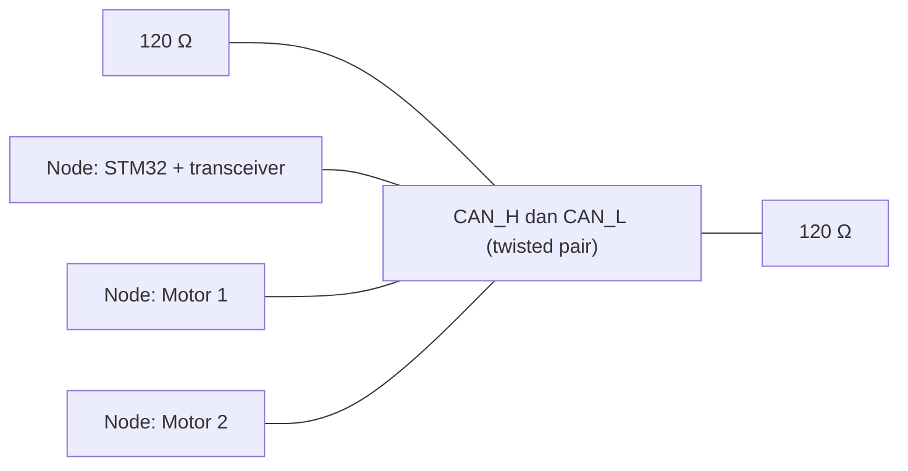
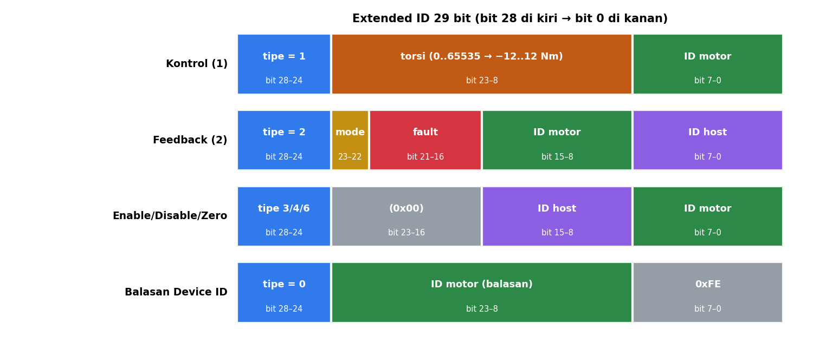
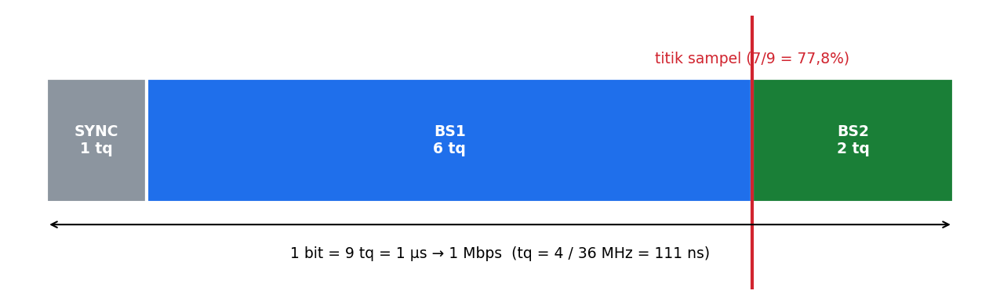

# Level 6: CAN Bus: Fisik, Frame, dan Timing

[← Level 5](05-struct-pointer.md) · [Beranda](../README.md) · [Level 7: Protokol →](07-protokol-decode.md)

> [!NOTE]
> Tujuan level ini: memahami **kenapa CAN dirancang begini** dan menghitung sendiri pengaturan kecepatan (bit timing) bxCAN. Level ini menyiapkan kamu untuk Level 8 (hardware) dan menjawab pertanyaan teori saat demo.

## Tujuan belajar

- [ ] Menjelaskan sinyal diferensial, dominant, dan recessive
- [ ] Menjelaskan terminasi 120 Ω dan cara mengeceknya dengan multimeter
- [ ] Membaca struktur Extended CAN frame dan menghitung durasinya
- [ ] Menjelaskan arbitrasi dan ACK
- [ ] Menghitung prescaler, BS1, dan BS2 untuk 1 Mbps

**Prasyarat:** [Level 2](02-extended-id.md).

---

## 🧠 Konsep

### 1. Apa itu CAN bus

CAN (*Controller Area Network*) menghubungkan banyak **node** pada satu **bus** dua kabel: **CAN_H** dan **CAN_L**. Semua node tersambung **paralel** pada kabel utama (*backbone*).

Setiap node terdiri dari tiga bagian (dari modul): **mikrokontroler** (logika), **CAN controller** (aturan protokol, di dalam MCU: bxCAN), dan **CAN transceiver** (mengubah sinyal digital ↔ diferensial).

### 2. Sinyal diferensial

Bit dibaca dari **selisih tegangan** CAN_H dan CAN_L, bukan dari tegangan terhadap ground. Noise yang menyerang kedua kabel sama-sama cenderung menghilang saat dikurangkan.

| Logika | Nama | CAN_H | CAN_L | Selisih |
|:-:|---|---|---|---|
| 0 | **dominant** | 3,5 V | 1,5 V | ≈ 2 V |
| 1 | **recessive** | 2,5 V | 2,5 V | ≈ 0 V |

**Dominant mengalahkan recessive:** jika satu node mengirim 0 dan lainnya 1, bus bernilai 0. Sifat ini menjadi dasar arbitrasi.

### 3. Terminasi 120 Ω

Dua resistor 120 Ω dipasang di **kedua ujung fisik** backbone, bukan di tiap node. Fungsinya menyesuaikan impedansi kabel supaya sinyal tidak memantul (*reflection*).

**Cek dengan multimeter (daya mati):** ukur resistansi antara CAN_H dan CAN_L.

| Terbaca | Artinya |
|---|---|
| ≈ **60 Ω** | dua terminasi 120 Ω paralel → benar |
| ≈ 120 Ω | hanya satu terminasi |
| tak hingga / sangat besar | tidak ada terminasi |
| ≈ 0 Ω | CAN_H dan CAN_L korslet |

### 4. Struktur Extended frame

Satu Extended frame berisi (urut): SOF, 11 bit ID dasar, SRR, IDE, 18 bit ID tambahan (**total ID 29 bit**), RTR, bit cadangan, **DLC** (panjang data, 4 bit), **data 0 sampai 8 byte**, **CRC 15 bit**, **ACK**, dan EOF.

**Hitung panjang satu frame (data 8 byte, tanpa bit stuffing):**

| Bagian | Bit |
|---|---:|
| SOF | 1 |
| ID dasar 11 + SRR 1 + IDE 1 + ID tambahan 18 + RTR 1 | 32 |
| r1 + r0 | 2 |
| DLC | 4 |
| Data 8 byte | 64 |
| CRC 15 + delimiter 1 | 16 |
| ACK slot 1 + delimiter 1 | 2 |
| EOF | 7 |
| Jeda antar frame (IFS) | 3 |
| **Total** | **131** |

Pada 1 Mbps, 1 bit = 1 µs, sehingga satu frame **≈ 131 µs**. Dengan *bit stuffing* (sisipan bit setelah 5 bit sama), worst case sekitar 160 µs.

**Beban bus** untuk satu motor pada 100 Hz (1 frame kontrol + 1 feedback per siklus): $2 \times 131\ \mu s \times 100 = 26{,}2\ ms$ per detik, yaitu **≈ 2,6%**. Dua motor ≈ 5,2%. Sangat longgar.

### 5. Arbitrasi dan ACK

**Arbitrasi:** node yang mengirim bersamaan membandingkan bitnya satu per satu mulai dari ID tertinggi. Node yang mengirim recessive (1) tetapi melihat bus dominant (0) langsung **mundur** dan menjadi penerima. **ID bernilai lebih kecil menang**, dan frame pemenang tidak rusak.

**ACK:** penerima yang berhasil mengecek CRC menarik slot ACK menjadi dominant. Jika **tidak ada satu pun node yang mengirim ACK**, pengirim menganggapnya error dan (jika auto-retransmit aktif) **terus mengulang**.

> [!IMPORTANT]
> Ini alasan pertama kalau STM32-mu "mengirim tapi tidak ada yang terjadi": tanpa node lain yang menjawab ACK (motor mati, kabel salah, baud beda), mailbox kirim **tertahan** dan error counter naik. Di Level 8 kamu akan memakai mode *loopback* untuk menguji tanpa motor.

### 6. Bit timing bxCAN

Satu bit CAN dibagi menjadi potongan kecil bernama **time quanta (tq)**:

| Segmen | Fungsi |
|---|---|
| SYNC | selalu 1 tq, tempat tepi sinyal diharapkan |
| BS1 | sebelum titik sampel |
| BS2 | setelah titik sampel |

Rumusnya (clock bus APB1 = 36 MHz pada konfigurasi proyek):

$$ t_q = \frac{\text{prescaler}}{f_{APB1}} \qquad N_{tq} = 1 + BS1 + BS2 \qquad \text{baud} = \frac{f_{APB1}}{\text{prescaler} \times N_{tq}} $$

$$ \text{titik sampel} = \frac{1 + BS1}{1 + BS1 + BS2} $$

**Contoh (setelan proyek): prescaler = 4, BS1 = 6, BS2 = 2.**

$$ N_{tq} = 1 + 6 + 2 = 9 \qquad \text{baud} = \frac{36\,000\,000}{4 \times 9} = 1\,000\,000 \qquad \text{sampel} = \frac{7}{9} = 77{,}8\% $$

Titik sampel sekitar 75–87% adalah praktik yang umum.

> [!NOTE]
> Di register BTR, setiap nilai disimpan **dikurangi 1** (prescaler 4 jadi 3, BS1 6 jadi 5, BS2 2 jadi 1). Kamu akan memakai ini lagi di Level 15.

---

## 🧪 Latihan

### 6A. Hitung bit timing

Isi tabel (APB1 = 36 MHz):

| Target baud | $N_{tq}$ | BS1 | BS2 | Prescaler | Titik sampel |
|---|---:|---:|---:|---:|---:|
| 1 Mbps | 9 | 6 | 2 | 4 | 77,8% |
| 1 Mbps | 12 | 8 | 3 | ? | ? |
| 1 Mbps | 18 | 13 | 4 | ? | ? |
| 500 kbps | 9 | 6 | 2 | ? | 77,8% |
| 250 kbps | 9 | 6 | 2 | ? | 77,8% |

▶ Kunci jawaban

Prescaler $= f_{APB1} / (\text{baud} \times N_{tq})$:
- 1 Mbps, 12 tq: $36 / (1 \times 12) = 3$; sampel $9/12 = 75\%$
- 1 Mbps, 18 tq: $36 / 18 = 2$; sampel $14/18 = 77{,}8\%$
- 500 kbps: $36\,000\,000/(500\,000 \times 9) = 8$
- 250 kbps: $= 16$

### 6B. Kalkulator di C (opsional)

Tulis program yang menerima baud target dan mencetak semua kombinasi (prescaler, BS1, BS2) yang menghasilkan baud tepat dengan titik sampel antara 70% dan 90%. Latihan loop bertingkat yang bagus, dan hasilnya berguna kalau suatu saat motor lain memakai baud berbeda.

### 6C. Arbitrasi di kertas

Dua node mengirim bersamaan:
- Node X: kontrol, ID `0x017FFF22`
- Node Y: feedback, ID `0x028422FD`

Tulis keduanya dalam biner 29 bit, bandingkan dari bit 28 ke bawah. **Siapa yang menang dan di bit ke berapa node yang kalah mundur?**

▶ Kunci jawaban

Bit 28..24 untuk X adalah `00001`, untuk Y `00010`. Bit 28, 27, 26 sama (0). Di **bit 25**, X mengirim 0 (dominant) dan Y mengirim 1 (recessive); Y melihat bus 0, jadi Y mundur. **X menang** (ID lebih kecil).

### 6D. Hitung beban bus

Dua motor, kontrol dan feedback pada 200 Hz. Berapa persen beban bus? Bagaimana jika frame 160 µs (worst case)?

▶ Kunci jawaban

Per motor per siklus 2 frame. Total 4 frame × 131 µs × 200 = 104,8 ms per detik → **10,5%**. Dengan 160 µs: 4 × 160 × 200 = 128 ms → **12,8%**.

### 6E. Kamus istilah (cek Level 0D)

Bandingkan jawaban kamus istilahmu di Level 0D dengan isi level ini. Perbaiki yang kurang tepat.

---

## ✅ Checkpoint: lulus jika

- [ ] Kamu bisa menjelaskan dominant vs recessive tanpa catatan
- [ ] Tabel 6A benar
- [ ] Kamu bisa menjelaskan apa yang terjadi jika tidak ada node yang mengirim ACK

## ❓ Cek pemahaman

**1.** Kenapa CAN memakai dua kabel diferensial dan bukan satu kabel + ground?

**2.** Multimeter membaca 120 Ω antara CAN_H dan CAN_L. Apa kemungkinan penyebabnya?

**3.** Prescaler = 6, BS1 = 3, BS2 = 2, APB1 = 36 MHz. Berapa baud?

**4.** Kenapa ID kecil punya prioritas tinggi?

▶ Kunci jawaban (tulis jawabanmu dulu)

1. Noise yang menyerang kedua kabel cenderung sama sehingga hilang saat dikurangkan; pembacaan tidak bergantung tegangan absolut terhadap ground.
2. Hanya satu terminasi terpasang (atau satu terminasi putus). Seharusnya ≈ 60 Ω.
3. $N_{tq} = 1 + 3 + 2 = 6$; baud $= 36\,000\,000 / (6 \times 6) = 1\,000\,000$ → 1 Mbps.
4. Dominant (0) mengalahkan recessive (1); ID kecil punya bit 0 lebih awal, sehingga menang saat dibandingkan dari bit tertinggi.

---

[← Level 5](05-struct-pointer.md) · [Beranda](../README.md) · [Level 7: Protokol →](07-protokol-decode.md)
