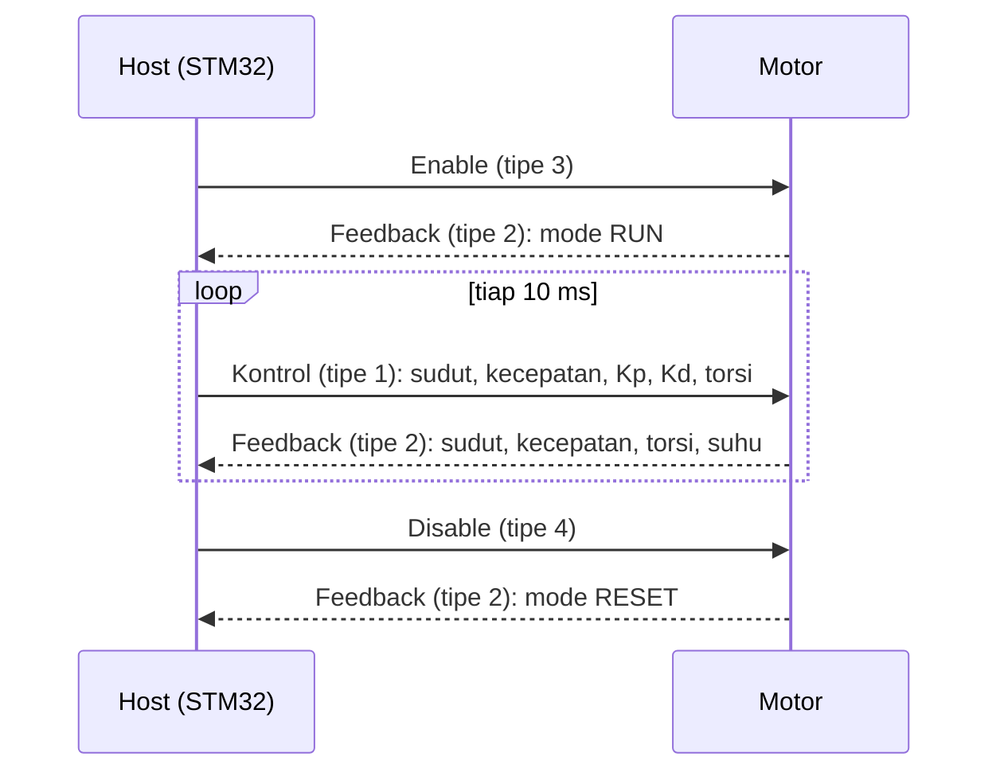
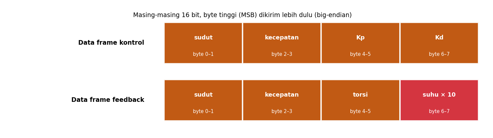
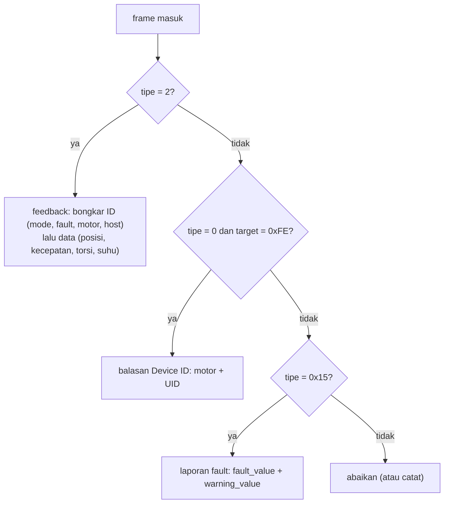

# Level 7: Protokol CyberGear dan Decode Feedback

[← Level 6](06-can-bus.md) · [Beranda](../README.md) · [Level 8: Bring-up →](08-bringup-can.md)

> [!NOTE]
> Tujuan level ini: membaca **manual motor** dengan benar dan membangun fungsi decode (`temperature`, `fault`, `mode`, dan lainnya) yang diminta Tugas 1b. Semua dikerjakan di laptop dan diuji dengan frame contoh, sebelum menyentuh motor.

## Tujuan belajar

- [ ] Memahami urutan komunikasi host ↔ motor
- [ ] Membongkar frame feedback: posisi, kecepatan, torsi, suhu, mode, fault
- [ ] Memahami dua mekanisme fault (6 bit di ID dan laporan tipe 21)
- [ ] Mengimplementasikan decode dan mengujinya

**Prasyarat:** Level 2, 3, 4. Folder: `exercises/level-07-decode/`.

---

## 🧠 Konsep

### 1. Siapa bicara apa

Pertukaran dasar antara **host** (STM32, ID 253 pada library) dan **motor**:



(Balasan feedback terhadap perintah mengikuti §4 manual; selalu cek di manual yang kamu pegang.)

### 2. Frame feedback (tipe 2)

**ID** (29 bit):

| Bit | Isi | Catatan |
|---|---|---|
| 28..24 | tipe = 2 | |
| 23..22 | **status mode** | 0 = Reset, 1 = Kalibrasi, 2 = Run |
| 21..16 | **info fault** (6 bit) | lihat di bawah |
| 15..8 | **ID motor** | pengirim feedback |
| 7..0 | **ID host** | tujuan |

**Data** (8 byte, semua 16 bit **big-endian**):



| Byte | Isi | Rentang | Dekode |
|---|---|---|---|
| 0–1 | sudut | −4π .. 4π rad | `uint_to_float(raw, -4π, 4π)` |
| 2–3 | kecepatan | −30 .. 30 rad/s | `uint_to_float(raw, -30, 30)` |
| 4–5 | torsi | −12 .. 12 Nm | `uint_to_float(raw, -12, 12)` |
| 6–7 | **suhu** | °C × 10 | `raw / 10.0f` |

**Suhu** adalah satu-satunya yang *tidak* memakai interpolasi: nilai mentah langsung 10 kali suhu. Mentah `355` berarti **35,5 °C**.

### 3. Fault: dua tingkat

**Tingkat 1: 6 bit di ID feedback** (bit 21..16). Ini yang selalu ikut di tiap feedback:

| Bit di ID | Bit di field `fault_bits` | Arti |
|:-:|:-:|---|
| 21 | 5 | belum dikalibrasi |
| 20 | 4 | kesalahan encoder HALL |
| 19 | 3 | kesalahan encoder magnetik |
| 18 | 2 | **suhu berlebih** |
| 17 | 1 | **arus berlebih** |
| 16 | 0 | **tegangan kurang** |

**Tingkat 2: frame laporan fault (tipe 21 / `0x15`)** berisi dua nilai 32 bit: *fault value* (data[0..3]) dan *warning value* (data[4..7]). Bit yang diketahui dari manual:

| Bit fault | Arti |
|:-:|---|
| 0 | suhu berlebih (default 80 °C) |
| 1 | kesalahan driver chip |
| 2 | tegangan kurang |
| 3 | tegangan lebih |
| 4 | arus lebih fase B |
| 5 | arus lebih fase C |
| 7 | encoder belum dikalibrasi |
| 15..8 | kelebihan beban (overload) |
| 16 | arus lebih fase A |

Warning: bit 0 = peringatan suhu berlebih (default 75 °C).

> [!WARNING]
> **Yang tidak dijelaskan manual:** urutan byte nilai 32 bit pada frame tipe 21 (kita *asumsikan little-endian*, seperti parameter), dan penempatan ID host/motor pada frame tipe 21 (manual menuliskannya dari sisi host). Verifikasi dengan motor nyata di Level 11 sebelum percaya sepenuhnya, dan **jangan sebut asumsi ini sebagai fakta saat demo**.

### 4. Balasan Get Device ID (tipe 0)

Saat host mengirim tipe 0 ke suatu ID motor, motor yang ada menjawab dengan frame tipe 0: ID motor di bit 15..8, **`0xFE` di bit 7..0**, dan 8 byte data berisi pengenal unik MCU. Ini bahan Level 12 (mencari ID yang tidak diketahui).

### 5. Alur decode



---

## 🧪 Latihan

### 7A. Decode dengan tangan

**Frame 1.** ID `0x028022FD`, data `7F FF 7F FF 7F FF 01 2C`.

**Frame 2.** ID `0x028422FD`, data `7F FF 7F FF 7F FF 03 20`.

**Frame 3 (tipe 21).** ID `0x1500FD22`, data `01 00 00 00 01 00 00 00`.

Untuk Frame 1 dan 2, tulis: mode, fault bits (dan artinya), motor, host, dan suhu. Untuk Frame 3: fault value dan warning value beserta artinya.

<details>
<summary>▶ Kunci jawaban</summary>

- **Frame 1:** tipe 2; bit 23 menyala dan bit 22 mati → mode 2 (**RUN**); fault 0; motor `0x22` = 34; host 253. Suhu raw `0x012C` = 300 → **30,0 °C**. Posisi, kecepatan, torsi mentah `0x7FFF` ≈ 0 (sedikit di bawah nol karena kuantisasi, misalnya posisi ≈ −0,00019 rad).
- **Frame 2:** mode RUN; fault `0b000100` → bit 18 = **suhu berlebih**; suhu raw `0x0320` = 800 → **80,0 °C** (batas default over-temp). Cocok: suhu sampai batas, fault menyala.
- **Frame 3:** fault value = 1 → bit 0 = **suhu berlebih**; warning value = 1 → **peringatan suhu**.

</details>

### 7B. Implementasi decode

Isi `exercises/level-07-decode/cg_decode.c`. Fungsi dari Level 2, 3, 4 milikmu dipakai di sini (Makefile otomatis menautkannya).

```bash
cd exercises && make test-07
```

<details>
<summary>▶ Petunjuk 1: <code>cg_decode_feedback</code></summary>

Urutan: (1) validasi pointer, tipe, dan dlc; (2) isi `motor_id`, `host_id` (target), `mode`, `fault_bits` memakai fungsi Level 2; (3) isi posisi/kecepatan/torsi dengan `uint_to_float(get_u16_be(...), min, max)`; (4) suhu: `get_u16_be(&f->data[6]) / 10.0f`.

</details>

<details>
<summary>▶ Petunjuk 2: <code>cg_decode_fault_bits</code></summary>

Satu pola untuk semua: `(bits >> n) & 1`. Pemetaan nomor `n` ada di tabel "Tingkat 1" di atas.

</details>

<details>
<summary>▶ Petunjuk 3: kenapa decode mengembalikan <code>bool</code>?</summary>

Frame yang bukan feedback (atau terlalu pendek) tidak boleh didecode sebagai feedback. Nilai `false` memberi tahu pemanggil: "ini bukan untukku, jangan ubah state apa pun".

</details>

### 7C. Eksperimen: frame rusak

Tulis tes tambahan sendiri: frame feedback dengan suhu `0xFFFF`. Berapa °C hasilnya? Apakah itu masuk akal, dan apa yang sebaiknya dilakukan driver (diam, atau menandai tidak valid)?

<details>
<summary>▶ Penjelasan</summary>

`65535 / 10` = 6553,5 °C: jelas mustahil. Driver bisa menandai suhu di atas ambang wajar (misalnya > 150 °C) sebagai tidak valid. Itu keputusan desain yang bagus untuk disebut saat demo.

</details>

### 7D. Ringkas manual (untuk demo)

Tanpa melihat catatan, tulis satu halaman: urutan komunikasi, peta ID feedback, peta data feedback, dua tingkat fault. Lalu bandingkan dengan §4 manual.

---

## ✅ Checkpoint: lulus jika

- [ ] `make test-07` menampilkan `SEMUA LOLOS`
- [ ] 7A benar tanpa melihat kunci
- [ ] Kamu bisa menjelaskan beda fault 6 bit di ID dan laporan tipe 21
- [ ] Kamu bisa menyebut asumsi yang belum terverifikasi

## ❓ Cek pemahaman

**1.** Di byte berapa suhu berada dan bagaimana mendekodenya?

**2.** Fault bits = `0b100000`. Apa artinya?

**3.** Kenapa balasan Get Device ID memakai target `0xFE`, bukan ID host?

**4.** Apa yang terjadi pada decode jika frame bertipe 3 dimasukkan ke `cg_decode_feedback`?

<details>
<summary>▶ Kunci jawaban (tulis jawabanmu dulu)</summary>

1. Byte 6–7 (big-endian), suhu = `raw / 10.0`.
2. Bit 5 = bit 21 ID = motor **belum dikalibrasi**.
3. Manual hanya menuliskan `0xFE` di bit 7..0 balasan tipe 0; itu penanda khusus untuk balasan identifikasi (bukan ID host). Yang pasti dipakai driver: balasan dikenali dari **tipe 0 dan target `0xFE`** (lihat `cg_decode_device_id`).
4. Ditolak (`false`) karena tipe ≠ 2, dan struct hasil tidak diubah.

</details>

---

[← Level 6](06-can-bus.md) · [Beranda](../README.md) · [Level 8: Bring-up →](08-bringup-can.md)
