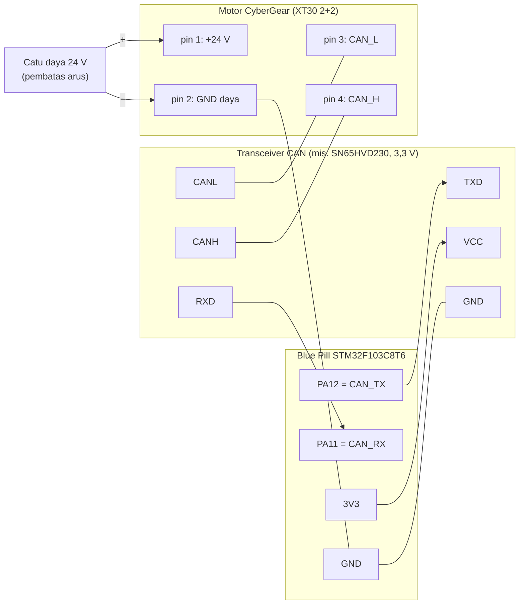

# Level 8: Bring-up Hardware: Wiring, Keselamatan, dan Loopback

[← Level 7](07-protokol-decode.md) · [Beranda](../README.md) · [Level 9: Baca Library →](09-baca-library.md)

> [!NOTE]
> Tujuan level ini: membawa sistem dari "kabel di meja" sampai "frame CAN terkirim dan balasan motor pertama terbaca", **dengan urutan yang aman**. Kita memulai dari yang paling tidak berisiko (loopback tanpa motor), lalu naik bertahap.

## Tujuan belajar

- [ ] Merakit STM32 + transceiver + motor dengan benar
- [ ] Menerapkan checklist keselamatan untuk motor 24 V
- [ ] Mengonfigurasi bxCAN di CubeMX (1 Mbps) dan membaca setelannya
- [ ] Menguji jalur kirim/terima dengan **mode loopback** tanpa motor
- [ ] Membaca register error untuk mendiagnosis bus

**Prasyarat:** [Level 6](06-can-bus.md), [Level 7](07-protokol-decode.md).

---

## 1. Wiring



| Dari | Ke | Catatan |
|---|---|---|
| PA12 (CAN_TX) | TXD transceiver | MCU → transceiver |
| PA11 (CAN_RX) | RXD transceiver | transceiver → MCU |
| 3V3 Blue Pill | VCC transceiver (3,3 V) | **jangan 5 V** pada modul 3,3 V |
| GND Blue Pill | GND transceiver **dan** minus 24 V | satukan GND |
| CANH / CANL | pin 4 / pin 3 konektor motor | **twisted pair**, jangan tertukar |
| +24 V / − | pin 1 / pin 2 motor | lewat catu daya terbatas arus |
| 120 Ω | antara CANH dan CANL di **kedua ujung** | lihat catatan terminasi |

> [!IMPORTANT]
> **Pilih transceiver dengan sadar.** SN65HVD230 bekerja di 3,3 V dan langsung cocok dengan Blue Pill. Modul TJA1050/MCP2551 butuh 5 V; keluaran RXD-nya bisa 5 V. Sepengetahuanku PA11/PA12 pada F103 termasuk pin yang toleran 5 V, tetapi **verifikasi di datasheet** (tabel *pin definitions*, kolom I/O level `FT`) sebelum memakai.

> [!NOTE]
> **Terminasi.** Spesifikasi CAN membutuhkan 120 Ω di kedua ujung. Beberapa modul transceiver sudah membawa resistor 120 Ω (kadang bisa dilepas dengan jumper). Ukur sebelum menambah (lihat latihan 8A). Dengan satu motor dan satu STM32, kamu hanya perlu **dua** terminasi total pada dua ujung bus.

> [!WARNING]
> **USB dan CAN tidak bisa dipakai bersamaan pada STM32F103.** Keduanya berbagi pin PA11/PA12 dan SRAM khusus. Project P5 sudah hanya mengaktifkan CAN. Jika kamu memakai project P4 sebagai dasar (yang mengaktifkan USB), **matikan USB** terlebih dulu.

## 2. Checklist keselamatan (WAJIB dibaca)

Motor ini bertorsi puncak 12 N·m dan arus puncak 23 A. Anggap seperti alat yang bisa melukai.

- [ ] Motor **dijepit/dibaut** ke meja. Jangan pernah memegangnya saat berdaya.
- [ ] Poros bebas dari kabel, rambut, jari, dan benda lain. Jangan pasang beban apa pun dulu.
- [ ] Catu daya: **16–28 V**, pakai **24 V**. Atur **pembatas arus kecil dulu** (mis. 1–2 A) saat uji awal.
- [ ] Ada **saklar daya** yang mudah dijangkau dan kamu tahu cara memutusnya dengan satu gerakan.
- [ ] Polaritas daya diperiksa dua kali sebelum dinyalakan.
- [ ] Kode awal: **Kp = 0, Kd = 0, torsi = 0**. Naikkan sedikit-sedikit.
- [ ] Selalu ada cara mengirim **Disable** (tipe 4) dari program; jangan hanya mengandalkan reset.
- [ ] Jangan mengubah ID/baud (tipe 7 / tipe 22) pada bus yang berisi lebih dari satu motor.
- [ ] Setelah selesai, matikan daya motor **sebelum** mencabut kabel CAN.

> [!CAUTION]
> Manual menyebut suhu board kontrol maksimum 80 °C. Jika suhu mendekati itu (lihat decode suhu di Level 11), **matikan** dan biarkan dingin.

## 3. Konfigurasi bxCAN di CubeMX

Pada project yang diberikan, CAN sudah dikonfigurasi. Pastikan kamu **bisa membaca** setelannya (dan kenapa):

| Parameter (CubeMX) | Nilai | Arti |
|---|---|---|
| Prescaler | **4** | $t_q = 4/36\,\text{MHz} = 111\,\text{ns}$ |
| Time Quanta in Bit Segment 1 | **6** | BS1 |
| Time Quanta in Bit Segment 2 | **2** | BS2 |
| ReSynchronization Jump Width | 1 | SJW |
| Hasil | $36\,\text{MHz}/(4 \times 9) = $ **1 Mbps** | sesuai bit rate motor (1 Mbps) |
| Operating Mode | `Normal` | untuk motor; `Loopback` untuk uji |
| Auto Retransmission | Enable | kirim ulang jika tidak di-ACK |
| NVIC | CAN1 RX0 interrupt aktif | frame masuk memicu callback |

Pin: PA11 = `CAN_RX`, PA12 = `CAN_TX`. Clock APB1 harus 36 MHz (HCLK 72 MHz, APB1 /2).

### Mode CAN pada bxCAN

| Mode | Perilaku | Dipakai untuk |
|---|---|---|
| **Normal** | kirim dan terima di bus nyata, butuh node lain untuk ACK | operasi sebenarnya |
| **Loopback** | frame kirimanmu diterima sendiri; pin RX diabaikan, TX tetap keluar | uji kode tanpa motor |
| **Silent** | hanya mendengar; tidak mengirim ke bus | menyadap bus tanpa mengganggu |
| **Silent + Loopback** | internal murni; tidak menyentuh bus | uji paling aman |

### Urutan inisialisasi yang dilakukan library

```c
HAL_CAN_ConfigFilter(...);                              // filter 0: terima semua (mask 0)
HAL_CAN_Start(&hcan);                                   // keluar dari init, ikut bus
HAL_CAN_ActivateNotification(&hcan, CAN_IT_RX_FIFO0_MSG_PENDING); // interrupt saat ada frame
```

Filter dengan ID 0 dan mask 0 meloloskan **semua** frame (setiap bit "don't care").

## 4. Kirim dan terima dengan HAL

```c
CAN_TxHeaderTypeDef h;
h.ExtId = 0x0300FD22;  h.IDE = CAN_ID_EXT;  h.RTR = CAN_RTR_DATA;
h.DLC = 8;  h.StdId = 0;  h.TransmitGlobalTime = DISABLE;

uint8_t data[8] = {0};
uint32_t mailbox;
HAL_StatusTypeDef st = HAL_CAN_AddTxMessage(&hcan, &h, data, &mailbox);   // HAL_OK jika ada mailbox kosong
```

Penerimaan lewat callback (dipanggil dari interrupt):

```c
volatile uint32_t rx_count = 0;
volatile uint32_t last_id = 0;

void HAL_CAN_RxFifo0MsgPendingCallback(CAN_HandleTypeDef *hcan)
{
    CAN_RxHeaderTypeDef rh;
    uint8_t d[8];
    if (HAL_CAN_GetRxMessage(hcan, CAN_RX_FIFO0, &rh, d) == HAL_OK) {
        last_id = rh.ExtId;
        rx_count++;
    }
}
```

**Tiga mailbox kirim.** bxCAN F103 punya **3** mailbox kirim. Jika kamu memanggil `HAL_CAN_AddTxMessage` lebih dari 3 kali berturut-turut sebelum ada yang terkirim, panggilan berikutnya mengembalikan `HAL_ERROR` (tidak ada mailbox bebas). Periksa dulu dengan `HAL_CAN_GetTxMailboxesFreeLevel(&hcan)`.

## 5. Membaca error bus

Di Live Expressions, tambahkan `hcan.Instance->ESR` (register status error):

| Bit | Nama | Arti |
|---|---|---|
| 0 | EWGF | peringatan error (counter ≥ 96) |
| 1 | EPVF | error pasif |
| 2 | BOFF | **bus-off** (counter > 255, node berhenti) |
| 6..4 | LEC | kode error terakhir (di bawah) |
| 23..16 | TEC | penghitung error kirim |
| 31..24 | REC | penghitung error terima |

| LEC | Arti | Penyebab umum |
|:-:|---|---|
| 0 | tidak ada error | |
| 1 | stuff error | baud tidak cocok, noise |
| 2 | form error | baud tidak cocok |
| **3** | **ACK error** | **tidak ada node lain** (motor mati, kabel/CANH-CANL salah, baud beda) |
| 4/5 | bit recessive/dominant error | bus korslet / terminasi buruk |
| 6 | CRC error | noise |

---

## 🧪 Latihan

### 8A. Ukur sebelum menyalakan

Dengan **semua daya mati**: (1) ukur resistansi CANH–CANL pada bus yang sudah dirakit; (2) tulis hasilnya; (3) bandingkan dengan tabel Level 6 (≈ 60 Ω ideal). Ukur juga: tidak ada hubungan pendek antara +24 V dan GND daya.

<details>
<summary>▶ Petunjuk: hasil ≠ 60 Ω</summary>

120 Ω berarti hanya satu terminasi; sangat besar berarti tidak ada terminasi; mendekati 0 Ω berarti CANH dan CANL korslet. Perbaiki sebelum lanjut.

</details>

### 8B. Loopback tanpa motor (uji kode kirim/terima)

1. Buat salinan project, ubah **Operating Mode = Loopback** di `.ioc`, Generate Code.
2. Jalankan `HAL_CAN_Start` dan aktifkan notifikasi RX FIFO0 (library `cybergear_init` melakukannya).
3. Kirim frame `0x0300FD22` (data nol) sekali tiap 500 ms (non-blocking dengan `HAL_GetTick`).
4. Di callback, simpan `last_id` dan naikkan `rx_count`.

**Tebak dulu:** berapa `last_id` dan bagaimana `rx_count`? Jalankan Debug dan lihat Live Expressions.

**Hasil yang diharapkan:** `last_id == 0x0300FD22` dan `rx_count` naik 1 tiap kirim, **tanpa kabel ke mana pun**. Ini membuktikan jalur kirim, filter, interrupt, dan callback-mu benar.

<details>
<summary>▶ Petunjuk: <code>rx_count</code> tidak naik</summary>

Periksa: (1) mode benar-benar Loopback; (2) `HAL_CAN_Start` dan `ActivateNotification` dipanggil; (3) NVIC untuk CAN RX0 aktif; (4) `HAL_CAN_AddTxMessage` mengembalikan `HAL_OK` (cek nilainya); (5) filter diaktifkan (ID 0/mask 0).

</details>

### 8C. Normal mode tanpa motor: lihat ACK error

Kembalikan mode ke **Normal**, hubungkan transceiver ke STM32, **tanpa motor**. Kirim frame seperti 8B. Pantau `HAL_CAN_GetTxMailboxesFreeLevel` dan `hcan.Instance->ESR`.

**Tebak:** apa LEC dan TEC-nya? Apakah mailbox kosong lagi?

<details>
<summary>▶ Penjelasan</summary>

Tanpa node penerima, tidak ada ACK. LEC menjadi 3 (**ACK error**), TEC naik, dan karena auto-retransmit aktif, mailbox tertahan mengulang terus. Ini membuktikan: **gejala "mengirim tapi tidak terjadi apa-apa" sering berarti tidak ada node di sisi lain** (atau baud/kabel salah), bukan bug di kode.

</details>

### 8D. Nyalakan motor dengan aman

1. Ulangi seluruh [checklist keselamatan](#2-checklist-keselamatan-wajib-dibaca).
2. Pembatas arus 1–2 A, nyalakan catu daya 24 V.
3. Amati: **LED merah** (daya) menyala; **LED biru** berkedip (MCU dan driver hidup).

Jika LED merah tidak menyala, **matikan daya segera** dan periksa polaritas dan tegangan.

### 8E. Kontak pertama: kirim lalu dengarkan

Dengan motor menyala dan CAN dalam mode Normal: kirim frame **Get Device ID** (`0x0000FD<ID>`) ke ID motor yang kamu ketahui (dari label atau catatan). Pantau `rx_count` dan `last_id`.

**Hasil yang diharapkan:** `rx_count` naik dan `last_id` berbentuk `0x0000<ID>FE` (balasan tipe 0 dengan `0xFE` di bit 7..0). Itu bukti seluruh rantai fisik bekerja.

<details>
<summary>▶ Petunjuk: tidak ada balasan</summary>

Urutan diagnosa: (1) ESR: LEC = 3? → belum ada ACK: periksa daya motor, CANH/CANL tidak tertukar, terminasi; (2) LEC = 1/2 → baud tidak cocok (cek prescaler/BS1/BS2); (3) tidak ada error tetapi tidak ada balasan → ID motor mungkin salah (lanjut ke Level 12: scan).

</details>

### 8F. Gambar ulang diagram

Bandingkan gambar Level 0C dengan diagram wiring di sini. Apa yang kurang pada gambarmu?

---

## ✅ Checkpoint: lulus jika

- [ ] 8B: `rx_count` naik dan `last_id` cocok di mode loopback
- [ ] 8C: kamu bisa menjelaskan kenapa terjadi ACK error tanpa motor
- [ ] 8E: balasan Get Device ID diterima dari motor nyata
- [ ] Kamu bisa menyebut tiga item checklist keselamatan tanpa melihat

## ❓ Cek pemahaman

**1.** Apa bedanya Loopback dan Silent?

**2.** `LEC = 3` dan TEC naik terus. Apa penyebab pertama yang kamu periksa?

**3.** Kenapa 4 pemanggilan `HAL_CAN_AddTxMessage` beruntun tanpa jeda bisa gagal?

**4.** Kenapa satu motor di bus hanya butuh dua terminasi, bukan tiga?

<details>
<summary>▶ Kunci jawaban (tulis jawabanmu dulu)</summary>

1. Loopback: kirimanmu diterima sendiri (uji internal) tetapi tetap mengirim ke pin TX. Silent: hanya mendengar bus; tidak mengirim apa pun ke bus.
2. Tidak ada node yang mengirim ACK: periksa daya motor, kabel CANH/CANL (tidak tertukar), terminasi, lalu kecocokan baud.
3. Hanya ada 3 mailbox kirim; yang keempat tidak mendapat tempat dan mengembalikan error.
4. Terminasi dipasang di **kedua ujung fisik** bus, bukan di tiap node; tiga resistor akan menurunkan impedansi bus di bawah yang diharapkan.

</details>

---

[← Level 7](07-protokol-decode.md) · [Beranda](../README.md) · [Level 9: Baca Library →](09-baca-library.md)
