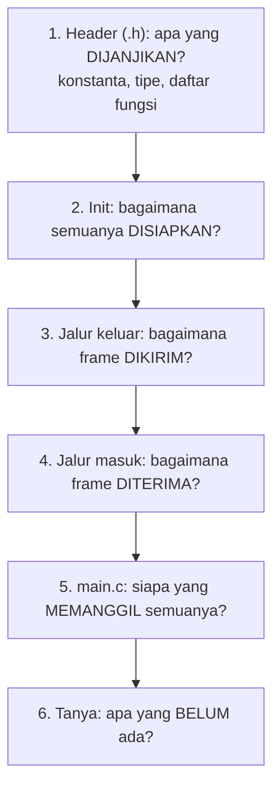

# Level 9: Membaca Library yang Diberikan

[← Level 8](08-bringup-can.md) · [Beranda](../README.md) · [Level 10: Tambah Fungsi →](10-tambah-fungsi.md)

> [!NOTE]
> Tujuan level ini: membaca `cyber_gear.h`, `cyber_gear.c`, dan `main.c` **seperti seorang reviewer**: memahami tiap bagian dan menemukan sendiri apa yang belum ada atau kurang aman. Hasilnya langsung menjadi bahan **Demo 1 dan 2** ("jelaskan kode" dan "apa yang kamu tambahkan dan ubah, serta alasannya").

## Tujuan belajar

- [ ] Menelusuri alur data dari `main.c` ke frame CAN dan kembali
- [ ] Menjelaskan tiap fungsi library dalam kalimat sendiri
- [ ] Menemukan celah (fungsi hilang, decode kurang, risiko bug)
- [ ] Menyusun rencana perubahan beralasan

**Prasyarat:** Level 2 sampai 5, 7. Level 8 membantu tetapi tidak wajib.

---

## 🧠 Konsep: cara membaca kode asing

Jangan membaca dari baris pertama sampai terakhir. Pakai urutan **atas ke bawah**:

Dua pertanyaan kunci di setiap fungsi: **"Apa masukannya?"** dan **"Apa yang berubah atau dikembalikan?"**

---

## 1. Peta library

### Header (`cyber_gear.h`)

| Bagian | Isi | Hubungan dengan level sebelumnya |
|---|---|---|
| `CYBERGEAR_MAX_MOTORS 8` | batas jumlah motor | Level 5 (`#define`) |
| `MIT_POSITION_MAX`, `MIT_VELOCITY_MAX`, `MIT_TORQUE_MAX`, `MIT_KP_MAX`, `MIT_KD_MAX` | batas skala | Level 4 |
| `enum CG_CommType` | tipe komunikasi (`CG_ENABLE`, `CG_FEEDBACK`, `CG_FAULT_FEEDBACK`, ...) | Level 2, 5 |
| `struct CG_Motor` | `id`, `position`, `velocity`, `torque`, `temperature`, `is_error`, `is_updated` | Level 5 |
| deklarasi fungsi | `cybergear_init`, `add_motor`, `get_motor`, `enable`, `disable`, `set_zero`, `send_motion`, `rx_handler` | |

### Fungsi di `cyber_gear.c`

| Fungsi | Tugas singkat |
|---|---|
| `float_to_uint`, `uint_to_float` (static) | skala float ↔ 16 bit (Level 4) |
| `cg_transmit(type, data_area, target, payload)` (static) | **satu-satunya** pintu keluar: menyusun ExtId, mengisi header, mengirim lewat `HAL_CAN_AddTxMessage` |
| `cybergear_init(hcan, host_id)` | menyimpan handle dan host ID, mengosongkan daftar motor, mengatur filter **terima-semua**, `HAL_CAN_Start`, mengaktifkan interrupt RX FIFO0 |
| `cybergear_add_motor` / `get_motor` | mengelola array `s_motors` (Level 5) |
| `cybergear_enable` / `disable` | memanggil `cg_transmit` dengan tipe 3 / 4 |
| `cybergear_send_motion` | menskala lima nilai, menyusun payload big-endian, torsi masuk ke data area |
| `cybergear_rx_handler` | membongkar frame **feedback** dan mengisi struct motor |

---

## 🧪 Latihan

### 9A. Telusuri satu frame dengan tangan

Panggilan: `cybergear_send_motion(34, 0.0f, 0.0f, 0.5f, 10.0f, 0.5f)` dengan host ID 253.

Tulis: (1) nilai mentah tiap field, (2) `ExtId` dalam hex, (3) 8 byte data.

▶ Petunjuk

Pakai rumus Level 4 untuk tiap nilai: torsi 0,5 pada rentang ±12; Kp 10 pada 0..500; Kd 0,5 pada 0..5. Torsi masuk ke **data area** (bit 23..8 ID), bukan ke data.

▶ Kunci jawaban

| Field | Perhitungan | Mentah |
|---|---|---|
| posisi 0 | $(0 + 4\pi) \times 65535 / 8\pi = 32767{,}5$ | `0x7FFF` |
| kecepatan 0 | $(0+30) \times 65535 / 60 = 32767{,}5$ | `0x7FFF` |
| torsi 0,5 | $(0{,}5 + 12) \times 65535 / 24 = 34132{,}8$ | `0x8554` |
| Kp 10 | $10 \times 65535 / 500 = 1310{,}7$ | `0x051E` |
| Kd 0,5 | $0{,}5 \times 65535 / 5 = 6553{,}5$ | `0x1999` |

`ExtId` = `0x01 << 24 | 0x8554 << 8 | 0x22` = **`0x01855422`**.
Data = `7F FF 7F FF 05 1E 19 99`.

### 9B. Telusuri jalur masuk

Frame feedback tiba: `ExtId = 0x028022FD`, data `7F FF 7F FF 7F FF 01 2C`. Ikuti `cybergear_rx_handler` **baris demi baris**:

1. Apakah lolos `IDE != CAN_ID_EXT`?
2. Berapa `host`, `motor_id`, `comm_type`?
3. Apakah lolos `host != s_host_id`? Apakah lolos `comm_type != CG_FEEDBACK`?
4. Field apa saja yang terisi di `CG_Motor`, dan field apa yang **tidak** terisi dari frame ini?

▶ Kunci jawaban

1. Ya, lolos (frame Extended).
2. host = `0xFD` = 253; motor_id = `0x22` = 34; comm_type = 2.
3. Lolos keduanya (host sama, tipe feedback), lanjut mencari motor 34.
4. Terisi: `position`, `velocity`, `torque`, `is_updated = true`. **Tidak terisi:** `temperature` (byte 6–7 diabaikan), mode (bit 23..22), fault (bit 21..16), dan `is_error`. Itu inti Tugas 1b.

### 9C. Pencarian celah (bug hunt)

Baca ulang `cyber_gear.c` dan `main.c`, lalu jawab pertanyaan pemandu ini **sebelum** membuka daftar temuan. Catat jawabanmu.

| # | Pertanyaan pemandu | Jawabanmu |
|--:|---|---|
| 1 | Bandingkan daftar fungsi di `.h` dan `.c` (latihan 0B). Adakah yang dideklarasikan tetapi tidak didefinisikan? | |
| 2 | Perintah apa dari manual (tipe 0, 4 dengan data, 7, 17, 18) yang tidak punya fungsi? | |
| 3 | Dalam `rx_handler`, frame bertipe 0 dengan target `0xFE` lolos pemeriksaan `host != s_host_id`? Apa dampaknya untuk mencari ID motor? | |
| 4 | Data apa di feedback yang dibuang? | |
| 5 | Di `main.c`, apa yang terjadi saat `enableFlag` berubah dari 1 ke 0? Urutkan perintah yang dikirim. | |
| 6 | `is_updated` ditulis di mana, dan dibaca di mana? Apakah ada yang menurunkannya? | |
| 7 | Apa yang terjadi jika `HAL_CAN_AddTxMessage` gagal (mailbox penuh)? Siapa yang tahu? | |
| 8 | Dalam `.ioc`, `AutoBusOff = DISABLE`. Apa artinya jika bus pernah error berat? | |
| 9 | `send_motion` dikirim tiap 10 ms. Apakah itu juga dikirim saat motor belum di-enable? Apakah itu masalah? | |

▶ Daftar temuan (buka setelah mengisi)

1. **`cybergear_set_zero` dideklarasikan di header tetapi tidak ada isinya di `.c`.** Memanggilnya menyebabkan error *undefined reference* saat link.
2. **Fungsi hilang:** Get Device ID (tipe 0), Clear Fault (tipe 4 dengan `data[0] = 1`), Set CAN ID (tipe 7), Param Read (0x11), Param Write (0x12) beserta pembantunya (run mode, referensi kecepatan/posisi/arus, batas), dan kontrol mode lain.
3. **Tidak lolos.** `rx_handler` menolak frame yang `host != s_host_id`, padahal balasan Get Device ID bertarget `0xFE`; dan hanya menerima `CG_FEEDBACK`. Maka balasan Device ID dan laporan fault (tipe `0x15`) **dibuang**, sehingga pencarian ID motor tidak mungkin tanpa mengubah handler.
4. **Suhu** (byte 6–7), **mode** (bit 23..22), dan **fault** (bit 21..16). `is_error` tidak pernah di-set.
5. Urutan yang terkirim: `cybergear_enable` **dulu**, lalu (karena `!enableFlag`) `cybergear_disable`. Jadi saat mematikan, motor sempat menerima perintah **Enable** sebelum **Disable**. Ini bug logika: `enable` seharusnya hanya dipanggil saat `enableFlag` menjadi 1.
6. Ditulis di **ISR** (lewat callback RX) dan dibaca di `main`. Variabelnya tidak `volatile`, dan library tidak pernah menurunkannya (tanggung jawab pemanggil). Nilai float dalam satu struct juga bisa terbaca tidak konsisten jika ISR menyela di tengah pembacaan.
7. `HAL_CAN_AddTxMessage` mengembalikan `HAL_ERROR`; library meneruskan nilainya, tetapi `main` hanya menyimpannya di variabel `state` dan tidak bereaksi. Perintah hilang tanpa jejak.
8. Setelah bus-off, node **tidak pulih sendiri**; harus ada penanganan perangkat lunak (mis. mendeteksi dan me-reset CAN). Tidak ada penanganan di library.
9. Ya, dikirim terus. Motor yang belum di-enable umumnya mengabaikan perintah kontrol, tetapi sebaiknya pengiriman dihentikan sampai motor di-enable, supaya bus tidak penuh dengan frame percuma dan niatnya jelas.

### 9D. Susun rencana perubahan

Dari temuanmu, isi tabel berikut. Ini **dokumen yang kamu pakai saat demo** untuk menjawab "apa yang kamu tambahkan dan ubah, dan kenapa?".

| Temuan | Perubahan yang kuusulkan | Alasan teknis | Level |
|---|---|---|---|
| `set_zero` tidak ada isinya | implementasikan (tipe 6, `data[0] = 1`) | mencegah error link; fitur dasar | 10 |
| Fungsi perintah hilang | tambahkan Get Device ID, Clear Fault, Set CAN ID, Param Read/Write, Run Mode | melengkapi protokol manual | 10 |
| Suhu, mode, fault tidak didecode | perluas `CG_Motor` dan `rx_handler` | Tugas 1b | 11 |
| Frame tipe 0 dan 0x15 dibuang | `rx_handler` memakai `switch (comm_type)` | scan ID dan laporan fault | 11, 12 |
| Bug enable/disable di `main` | perbaiki kondisi | perilaku benar | 11 |
| (milikmu sendiri) | | | |

Simpan tabel ini sebagai `docs/changelog.md` di repositori kerjamu dan perbarui di setiap level berikutnya.

---

## ✅ Checkpoint: lulus jika

- [ ] 9A dan 9B benar (kamu bisa menghitung frame dengan tangan)
- [ ] Kamu menemukan minimal 6 dari 9 celah sebelum membuka daftar
- [ ] Tabel rencana perubahan (9D) terisi dengan alasan teknis

## ❓ Cek pemahaman

**1.** Kenapa `cg_transmit` dijadikan satu-satunya pintu keluar?

**2.** Kenapa `rx_handler` mengembalikan `bool`?

**3.** Jelaskan kenapa bug enable/disable di `main` mungkin tidak terlihat saat uji sekilas.

▶ Kunci jawaban (tulis jawabanmu dulu)

1. Semua perintah berbagi satu tempat untuk menyusun ID dan mengirim; perubahan (mis. cek mailbox, logging) cukup dilakukan di satu tempat.
2. Memberi tahu pemanggil apakah frame itu dikenali dan dipakai; frame lain bisa diteruskan ke penanganan lain.
3. Urutan Enable lalu Disable terkirim sangat cepat (beda mikrodetik), sehingga motor tampak berhenti seperti yang diharapkan; efek sampingnya hanya terlihat jika kamu menyadap bus atau memperhatikan feedback.

---

[← Level 8](08-bringup-can.md) · [Beranda](../README.md) · [Level 10: Tambah Fungsi →](10-tambah-fungsi.md)
