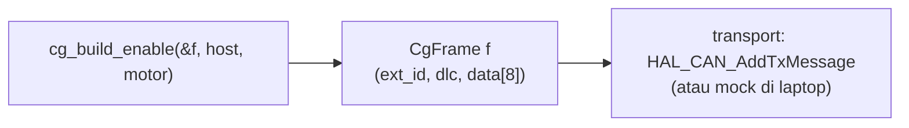

# Level 10: Melengkapi Library: Fungsi Perintah (Tugas 1a)

[← Level 9](09-baca-library.md) · [Beranda](../README.md) · [Level 11: Decode di Library →](11-decode-di-library.md)

> [!NOTE]
> Tujuan level ini: menambahkan fungsi yang belum ada di library. Strateginya: **bangun dan buktikan dulu di laptop** (frame persis benar sampai ke byte), baru pindahkan ke library STM32. Dengan cara ini, bug protokol ketahuan dalam hitungan detik, bukan setelah flash berkali-kali.

## Tujuan belajar

- [ ] Menyusun frame perintah (tipe 0, 4+data, 6, 7, 0x11, 0x12) dari spesifikasi
- [ ] Memisahkan "menyusun frame" dari "mengirim frame"
- [ ] Memindahkan fungsi yang sudah terbukti ke `cyber_gear.c`
- [ ] Menjelaskan tiap fungsi baru dan alasannya (Demo 2)

**Prasyarat:** Level 2, 3, 4, 9. Folder: `exercises/level-10-commands/`.

---

## 🧠 Konsep

### 1. Pola yang baik: *builder* murni

Daripada setiap fungsi langsung memanggil HAL, kita buat **builder**: fungsi yang hanya mengisi `CgFrame` (ID + data) tanpa mengirim.



Manfaatnya: builder bisa diuji di laptop, dan transport bisa diganti (HAL, mock, baremetal di Level 15, atau kelas C++ di Level 14).

### 2. Spesifikasi frame (semua dengan host = 253 dan motor = 34)

| Perintah | Tipe | data area 2 (bit 23..8) | Data (8 byte) | ExtId |
|---|:-:|---|---|---|
| Get Device ID | 0x00 | host | semua 0 | `0x0000FD22` |
| Enable | 0x03 | host | semua 0 | `0x0300FD22` |
| Disable | 0x04 | host | semua 0 | `0x0400FD22` |
| Clear Fault | 0x04 | host | `data[0] = 1` | `0x0400FD22` |
| Set Zero | 0x06 | host | `data[0] = 1` | `0x0600FD22` |
| Set CAN ID (baru 35) | 0x07 | `(35 << 8) \| host` | `data[0] = 1` | `0x0723FD22` |
| Param Read | 0x11 | host | `data[0..1]` = index **LE** | `0x1100FD22` |
| Param Write | 0x12 | host | index **LE**, nilai di `data[4..7]` **LE** | `0x1200FD22` |

**Perhatikan:** Disable dan Clear Fault memakai **tipe yang sama** (4); bedanya hanya `data[0]` (0 = stop, 1 = hapus fault).

### 3. Parameter

Tulis/baca parameter memakai **index** 16 bit (little-endian) dan nilai. Parameter yang paling sering dipakai:

| Index | Nama | Tipe | Arti |
|:-:|---|---|---|
| `0x7005` | `run_mode` | uint8 | 0 operasi (MIT), 1 posisi, 2 kecepatan, 3 arus |
| `0x7006` | `iq_ref` | float | referensi arus (A) |
| `0x700A` | `spd_ref` | float | referensi kecepatan (rad/s) |
| `0x700B` | `limit_torque` | float | batas torsi (Nm) |
| `0x7016` | `loc_ref` | float | referensi posisi (rad) |
| `0x7017` | `limit_spd` | float | batas kecepatan di mode posisi (rad/s) |
| `0x7018` | `limit_cur` | float | batas arus (A) di mode posisi/kecepatan |

**Contoh byte:** menulis `run_mode = 2` pada motor 34: ID `0x1200FD22`, data `05 70 00 00 02 00 00 00`. Menulis `spd_ref = 5.0` : `0A 70 00 00 00 00 A0 40` (`5.0f` = `0x40A00000` → LE `00 00 A0 40`).

> [!WARNING]
> Index parameter dan nilai float memakai **little-endian**, sedangkan sudut/kecepatan frame kontrol memakai **big-endian**. Ini jebakan nomor satu (Level 3). Kalau perintahmu "tidak berefek", curigai urutan byte dulu.

### 4. Tindakan berisiko

| Perintah | Risiko | Aturan |
|---|---|---|
| **Set CAN ID** | mengubah alamat motor; salah ID = motor "hilang" | **hanya** satu motor di bus, catat ID baru, minta izin asisten |
| **Set Zero** | mengubah acuan posisi 0 | aman, tetapi ingat posisi lama |
| **Param Write `run_mode`** | mode berbeda memberi perilaku berbeda | ikuti urutan di manual §4.2 (umumnya saat motor belum di-enable) |
| Perintah baud (tipe 22) | bisa memutus komunikasi | **jangan** dipakai di P5 |

---

## 🧪 Latihan

### 10A. Hitung frame dengan tangan

Pakai tabel §2. Tulis ExtId dan data untuk:

1. Enable motor **7** dari host **253**.
2. Set Zero motor **34** dari host **100**.
3. Param Write `run_mode = 1` ke motor **34** dari host 253.
4. Param Write `loc_ref = 1.0` (float) ke motor 34 dari host 253.

<details>
<summary>▶ Kunci jawaban</summary>

1. `0x0300FD07`, data nol.
2. `0x06006422`, `data[0] = 1` (host 100 = `0x64`).
3. `0x1200FD22`, data `05 70 00 00 01 00 00 00`.
4. `0x1200FD22`, index `0x7016` → `16 70`, `1.0f` = `0x3F800000` → `00 00 80 3F`: data `16 70 00 00 00 00 80 3F`.

</details>

### 10B. Implementasikan builder

Isi semua fungsi di `exercises/level-10-commands/cg_cmd.c`. Fungsi `frame_init` sudah disediakan, pakai di semua builder. Kamu memakai `cg_id_pack` (Level 2), `put_u16_*`/`put_f32_le` (Level 3), dan `float_to_uint` (Level 4) milikmu sendiri.

```bash
cd exercises && make test-10
```

<details>
<summary>▶ Petunjuk 1: enable, disable, get device id</summary>

Ketiganya hanya memanggil `frame_init(f, tipe, host, motor)`: `data2` berisi ID host dan `data` tetap nol.

</details>

<details>
<summary>▶ Petunjuk 2: clear fault dan set zero</summary>

Clear Fault = sama dengan Disable (tipe 4), ditambah `f->data[0] = 1`. Set Zero memakai tipe 6 dan juga `f->data[0] = 1`.

</details>

<details>
<summary>▶ Petunjuk 3: set CAN ID</summary>

ID baru ada di bit 23..16 dan host di bit 15..8, jadi `data2 = (uint16_t)((new_id << 8) | host)`. Jangan lupa `data[0] = 1`.

</details>

<details>
<summary>▶ Petunjuk 4: kontrol operasi (motion)</summary>

Torsi diskalakan ke 16 bit lalu masuk sebagai `data2` pada ID. Data: posisi di byte 0-1, kecepatan 2-3, **Kp** 4-5, **Kd** 6-7, semuanya `put_u16_be`. Gunakan batas dari `cg_defs.h` (`CG_POSITION_MAX`, ...).

</details>

<details>
<summary>▶ Petunjuk 5: parameter</summary>

`put_u16_le(&f->data[0], index)` untuk index; nilai uint8 di `f->data[4]`; nilai float lewat `put_f32_le(&f->data[4], value)`. `set_run_mode` cukup memanggil builder `param_write_u8` dengan index `CG_PARAM_RUN_MODE`.

</details>

### 10C. Pindahkan ke library STM32

Setelah `make test-10` lolos, tambahkan fungsi yang sama ke `cyber_gear.c`. Library sudah punya `cg_transmit(type, data_area, target, payload)` sebagai pintu keluar, jadi tiap fungsi baru cukup menyusun `payload` lalu memanggilnya.

**Contoh 1: `cybergear_set_zero`** (yang sekarang hanya dideklarasikan):

```c
HAL_StatusTypeDef cybergear_set_zero(uint8_t motor_id)
{
    uint8_t p[8] = {1, 0, 0, 0, 0, 0, 0, 0};
    return cg_transmit(CG_SET_ZERO, s_host_id, motor_id, p);
}
```

**Contoh 2: `cybergear_param_write_u8`:**

```c
HAL_StatusTypeDef cybergear_param_write_u8(uint8_t motor_id, uint16_t index, uint8_t value)
{
    uint8_t p[8] = {0};
    p[0] = index & 0xFF;      // index little-endian
    p[1] = index >> 8;
    p[4] = value;
    return cg_transmit(CG_PARAM_WRITE, s_host_id, motor_id, p);
}
```

**Yang harus kamu tulis sendiri** (tambahkan prototipenya di `cyber_gear.h`):

| Fungsi | Isi |
|---|---|
| `cybergear_get_device_id(motor_id)` | tipe 0, payload nol |
| `cybergear_clear_fault(motor_id)` | tipe 4, `p[0] = 1` |
| `cybergear_set_can_id(motor_id, new_id)` | tipe 7, `data_area = (new_id << 8) \| s_host_id`, `p[0] = 1` |
| `cybergear_param_read(motor_id, index)` | tipe 0x11, index LE di `p[0..1]` |
| `cybergear_param_write_f32(motor_id, index, value)` | seperti u8, tetapi `memcpy(&p[4], &value, 4)` |
| `cybergear_set_run_mode(motor_id, mode)` | memanggil `param_write_u8` dengan index `0x7005` |

Tambahkan juga konstanta di header: `CG_PARAM_RUN_MODE`, `CG_PARAM_SPD_REF`, `CG_PARAM_LOC_REF`, dan seterusnya.

> [!NOTE]
> `memcpy(&p[4], &value, 4)` menghasilkan little-endian **karena STM32F103 little-endian**. Itu benar di sini, tetapi kalau kode dipindah ke CPU big-endian hasilnya salah. Di laptop kamu sudah memakai `put_f32_le` yang tidak bergantung CPU. Bisa kamu jelaskan pilihan mana yang lebih aman dan kenapa?

### 10D. Uji di motor (aman dulu)

Dengan motor terpasang sesuai [Level 8](08-bringup-can.md) dan checklist keselamatan:

| Uji | Cara melihat hasilnya | Risiko |
|---|---|---|
| `cybergear_clear_fault` | tidak ada efek jika tidak ada fault; tidak ada error CAN | rendah |
| `cybergear_set_zero` | posisi feedback berikutnya mendekati 0 | rendah |
| `cybergear_param_write_u8(RUN_MODE, 0)` lalu `param_read(RUN_MODE)` | balasan tipe `0x11`: periksa `data[4]` di variabel debug | rendah |
| `cybergear_set_can_id` | **jangan**, kecuali diizinkan dan satu motor saja | tinggi |

Untuk melihat balasan sebelum Level 11, simpan frame mentah terakhir di callback RX:

```c
volatile uint32_t dbg_id;
volatile uint8_t  dbg_data[8];

void HAL_CAN_RxFifo0MsgPendingCallback(CAN_HandleTypeDef *hcan)
{
    CAN_RxHeaderTypeDef rh; uint8_t d[8];
    if (HAL_CAN_GetRxMessage(hcan, CAN_RX_FIFO0, &rh, d) == HAL_OK) {
        dbg_id = rh.ExtId;
        for (int i = 0; i < 8; i++) dbg_data[i] = d[i];
        cybergear_rx_handler(&rh, d);
    }
}
```

### 10E. Catatan untuk demo

Tambahkan satu baris per fungsi baru ke `docs/changelog.md` (dari Level 9D): **apa, kenapa, bagaimana kamu mengujinya**. Contoh: *"`cybergear_set_zero`: dideklarasikan tetapi tidak ada isinya sehingga error link; kuimplementasikan sebagai tipe 6 `data[0]=1`; kuuji dengan melihat posisi feedback mendekati 0."*

---

## ✅ Checkpoint: lulus jika

- [ ] `make test-10` menampilkan `SEMUA LOLOS`
- [ ] Semua fungsi baru sudah ada di library dan **proyek ter-build tanpa error**
- [ ] Minimal `clear_fault`, `set_zero`, dan `param_write/read run_mode` teruji di motor
- [ ] Tabel `changelog` terisi dengan alasan

## ❓ Cek pemahaman

**1.** Apa satu-satunya perbedaan frame Disable dan Clear Fault?

**2.** Tulis data untuk Param Read index `0x7006`.

**3.** Kenapa builder tidak langsung memanggil HAL?

**4.** Kenapa `set_can_id` tidak boleh diuji sembarangan?

<details>
<summary>▶ Kunci jawaban (tulis jawabanmu dulu)</summary>

1. `data[0]`: 0 (atau semua nol) untuk Disable, 1 untuk Clear Fault. Tipe dan ID sama.
2. `06 70 00 00 00 00 00 00` (index `0x7006` little-endian).
3. Supaya bisa diuji di laptop tanpa hardware, dan transport bisa diganti (HAL, mock, baremetal, kelas C++).
4. Mengubah alamat motor; jika salah atau lebih dari satu motor, kamu bisa kehilangan motor di bus atau menabrak ID motor lain.

</details>

---

[← Level 9](09-baca-library.md) · [Beranda](../README.md) · [Level 11: Decode di Library →](11-decode-di-library.md)
