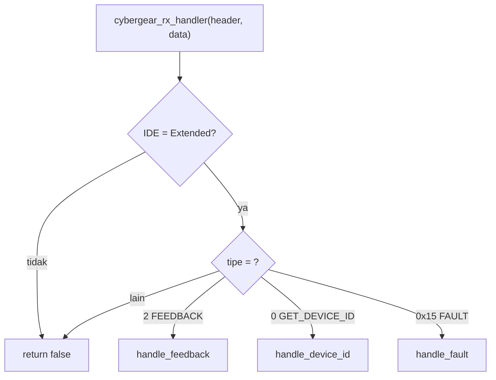

# Level 11: Decode Data Motor di Library (Tugas 1b)

[← Level 10](10-tambah-fungsi.md) · [Beranda](../README.md) · [Level 12: Dua Motor →](12-dua-motor-scan.md)

> [!NOTE]
> Tujuan level ini: membuat library **membaca** suhu, mode, dan fault dari motor (Tugas 1b), memperbaiki penerima frame, dan menguji semuanya, **termasuk fault yang tidak bisa dipicu dengan aman di motor**, lewat teknik *injeksi frame di mode loopback*.

## Tujuan belajar

- [ ] Memperluas `CG_Motor` dengan data baru
- [ ] Mengubah `rx_handler` menjadi `switch` per tipe komunikasi
- [ ] Memindahkan logika decode dari Level 7 ke library
- [ ] Menguji dengan injeksi frame (loopback) dan dengan motor nyata
- [ ] Memperbaiki bug enable/disable di `main`

**Prasyarat:** Level 7, 9, 10. Level 8 untuk pengujian di motor.

---

## 🧠 Konsep

### 1. Apa yang harus berubah

Dari Level 9 kita tahu `rx_handler` hanya mengambil posisi, kecepatan, torsi. Yang ditambahkan:

| Data | Sumber | Field baru di `CG_Motor` |
|---|---|---|
| Suhu | feedback, byte 6-7 ÷ 10 | `temperature` (sudah ada, belum diisi) |
| Mode | feedback, ID bit 23..22 | `mode` |
| Fault 6 bit | feedback, ID bit 21..16 | `fault_bits` |
| Flag error | turunan dari fault | `is_error` (sudah ada, belum diisi) |
| Laporan fault | frame tipe `0x15` | `fault_value`, `warning_value` |
| Pengenal motor | balasan Get Device ID | `uid[8]`, `online` |
| Waktu feedback | `HAL_GetTick()` saat diterima | `last_rx_ms` |

Struct yang diperluas:

```c
typedef struct {
    uint8_t  id;
    float    position, velocity, torque, temperature;
    uint8_t  mode;            // 0 reset, 1 kalibrasi, 2 run
    uint8_t  fault_bits;      // 6 bit dari ID feedback
    uint32_t fault_value;     // dari frame tipe 0x15
    uint32_t warning_value;
    bool     is_error;        // fault_bits != 0 atau fault_value != 0
    bool     is_updated;
    bool     online;          // sudah pernah menerima feedback
    uint8_t  uid[8];
    uint32_t last_rx_ms;
} CG_Motor;
```

### 2. Dispatcher berdasarkan tipe



```c
bool cybergear_rx_handler(const CAN_RxHeaderTypeDef *h, const uint8_t *d)
{
    if (h->IDE != CAN_ID_EXT) return false;
    uint32_t id   = h->ExtId;
    uint8_t  type = (id >> 24) & 0x1F;

    switch (type) {
    case CG_FEEDBACK:       return handle_feedback(id, d);
    case CG_GET_DEVICE_ID:  return handle_device_id(id, d);
    case CG_FAULT_FEEDBACK: return handle_fault(id, d);
    default:                return false;
    }
}
```

> [!IMPORTANT]
> Pemeriksaan `host != s_host_id` yang dulu ada di awal **harus dipindah ke dalam `handle_feedback`**. Balasan Get Device ID bertarget `0xFE`, bukan ID host; kalau pemeriksaan tetap di awal, balasan itu terus dibuang.

### 3. Batas ISR: singkat saja

`rx_handler` berjalan **di dalam interrupt**. Isinya hanya menyalin dan menghitung ringan (tanpa `HAL_Delay`, tanpa `printf` panjang). Menyimpan frame lalu memproses di `main` juga pilihan sah.

### 4. Frame fault (tipe 0x15): jangan berasumsi

Manual tidak menjelaskan dengan tegas penempatan ID motor/host pada frame tipe 21 dan urutan byte nilai 32 bit. Strategi aman: **coba dua kemungkinan ID motor** (bit 15..8 lalu bit 7..0) dan simpan ke motor yang terdaftar. Catat di changelog bahwa ini asumsi yang kamu verifikasi.

---

## 🧪 Latihan

### 11A. Perluas struct dan header

Tambahkan field di `cyber_gear.h`. Karena `cybergear_init` melakukan `memset(s_motors, 0, ...)`, semua field baru otomatis nol di awal. Build: apakah ada error?

### 11B. Tulis tiga handler

Di `cyber_gear.c`, tambahkan tiga fungsi `static` dan ubah `cybergear_rx_handler` seperti di atas. Kerangka:

```c
static bool handle_feedback(uint32_t id, const uint8_t *d)
{
    uint8_t host  = id & 0xFF;
    uint8_t motor = (id >> 8) & 0xFF;
    if (host != s_host_id) return false;

    CG_Motor *m = cybergear_get_motor(motor);
    if (m == NULL) return false;

    m->mode       = ____;                       // (id >> 22) & 0x03
    m->fault_bits = ____;                       // (id >> 16) & 0x3F
    /* posisi, kecepatan, torsi: sama seperti sebelumnya */
    m->temperature = ((d[6] << 8) | d[7]) / ____;   // dibagi 10, hati-hati integer
    m->is_error    = (m->fault_bits != 0);
    m->online      = true;
    m->last_rx_ms  = HAL_GetTick();
    m->is_updated  = true;
    return true;
}
```

> [!WARNING]
> `((d[6] << 8) | d[7]) / 10` adalah **pembagian integer** (hasil dipotong). Gunakan `10.0f`. Ini jebakan Level 3 dan 4.

<details>
<summary>▶ Petunjuk 1: <code>handle_device_id</code></summary>

Lolos hanya jika `(id & 0xFF) == 0xFE`. Motor ada di `(id >> 8) & 0xFF`. Jika motor terdaftar, salin 8 byte `d` ke `m->uid` (`memcpy`) dan set `m->online = true`.

</details>

<details>
<summary>▶ Petunjuk 2: <code>handle_fault</code></summary>

`fault_value` = `d[0] | d[1]<<8 | d[2]<<16 | d[3]<<24` (little-endian, asumsi), `warning_value` dari `d[4..7]`. Cari motor di `bit 15..8` lalu `bit 7..0`; yang pertama terdaftar menang. Set `is_error = true` jika `fault_value != 0`.

</details>

### 11C. Uji dengan injeksi frame (loopback, tanpa motor)

Fault dan suhu ekstrem **tidak aman dipicu di motor**. Solusinya: STM32 mengirim **frame palsu ke dirinya sendiri** dalam mode Loopback (Level 8B), lalu kita lihat apakah decode-mu benar.

1. Pasang mode **Loopback**, panggil `cybergear_add_motor(34)`.
2. Kirim frame palsu: ID `0x028422FD`, data `7F FF 7F FF 7F FF 03 20` (fault over-temp, 80,0 °C).
3. Baca `motor->temperature`, `mode`, `fault_bits`, `is_error` di Live Expressions.

```c
CAN_TxHeaderTypeDef h = { .StdId = 0, .ExtId = 0x028422FD, .IDE = CAN_ID_EXT,
                          .RTR = CAN_RTR_DATA, .DLC = 8, .TransmitGlobalTime = DISABLE };
uint8_t d[8] = { 0x7F, 0xFF, 0x7F, 0xFF, 0x7F, 0xFF, 0x03, 0x20 };
uint32_t mb;
HAL_CAN_AddTxMessage(&hcan, &h, d, &mb);
```

**Tabel yang harus kamu capai:**

| Frame yang disuntikkan | Hasil yang diharapkan |
|---|---|
| ID `0x028022FD`, suhu `01 2C` | `mode = 2`, `fault_bits = 0`, `temperature = 30,0`, `is_error = false` |
| ID `0x028422FD`, suhu `03 20` | `mode = 2`, `fault_bits = 4`, `temperature = 80,0`, `is_error = true` |
| ID `0x026022FD`, suhu `01 2C` | `mode = 1`, `fault_bits = 0x20` (belum dikalibrasi), `is_error = true` |
| ID `0x1500FD22`, data `01 00 00 00 01 00 00 00` | `fault_value = 1`, `warning_value = 1` (jika motor 34 terdaftar) |

Ini bukti kuat untuk demo: kamu **memverifikasi decode tanpa harus merusak motor**.

### 11D. Perbaiki bug di `main`

Ganti blok enable/disable yang bermasalah (Level 9C nomor 5). Logika yang benar:

```c
if (enableFlag != prevEnableFlag) {
    prevEnableFlag = enableFlag;
    if (enableFlag) cybergear_enable(MOTOR_ID);
    else            cybergear_disable(MOTOR_ID);
}
if (enableFlag) {
    state = cybergear_send_motion(MOTOR_ID, 0, 0, target_tor, kp, kd);
}
```

Perhatikan dua perbaikan: `enable` hanya saat flag menjadi 1, dan `send_motion` hanya saat sedang enable.

### 11E. Uji di motor nyata

Dengan checklist keselamatan, **Kp = 0, Kd = 0, torsi = 0**:

| Uji | Hasil yang diharapkan |
|---|---|
| Sebelum enable | `online = false` (belum ada feedback) |
| Setelah `enable` | `mode = 2`, `online = true`, `temperature` mendekati suhu ruang (sekitar 25–45 °C) |
| Setelah `disable` | `mode = 0` |
| Putar poros pelan dengan tangan (motor di-enable, Kp = 0) | `position` berubah, `velocity` bergerak |
| `last_rx_ms` | terus maju tiap 10 ms |

Jika suhu terbaca aneh (mis. 0 atau ribuan °C), cek urutan byte dan pembagian `10.0f`.

### 11F. Catatan demo

Tambahkan ke `changelog`: field baru, `switch` per tipe, pemindahan pemeriksaan host, bug `main`. Tulis **alasan** tiap perubahan dalam satu kalimat.

---

## ✅ Checkpoint: lulus jika

- [ ] Keempat baris tabel injeksi (11C) menghasilkan nilai yang diharapkan
- [ ] Suhu, mode, dan fault terbaca benar dari motor nyata (11E)
- [ ] Bug enable/disable diperbaiki dan kamu bisa menjelaskan sebabnya
- [ ] Kamu bisa menyebut asumsi yang belum terverifikasi (fault frame)

## ❓ Cek pemahaman

**1.** Kenapa pemeriksaan host dipindah ke dalam `handle_feedback`?

**2.** Kenapa suhu dibagi `10.0f`, bukan `10`?

**3.** Kenapa fault tidak diuji dengan memicunya di motor?

**4.** Apa risiko menaruh banyak pekerjaan di dalam `rx_handler`?

<details>
<summary>▶ Kunci jawaban (tulis jawabanmu dulu)</summary>

1. Balasan Get Device ID bertarget `0xFE`, bukan ID host; pemeriksaan host di awal akan membuangnya.
2. Pembagian integer memotong pecahan: `355 / 10 = 35`, bukan 35,5.
3. Memicu over-temp, over-current, atau under-voltage bisa merusak atau membahayakan; injeksi frame membuktikan kode decode tanpa risiko.
4. `rx_handler` berjalan dalam interrupt; pekerjaan lama menahan interrupt lain dan bisa membuat frame hilang saat bus ramai.

</details>

---

[← Level 10](10-tambah-fungsi.md) · [Beranda](../README.md) · [Level 12: Dua Motor →](12-dua-motor-scan.md)
