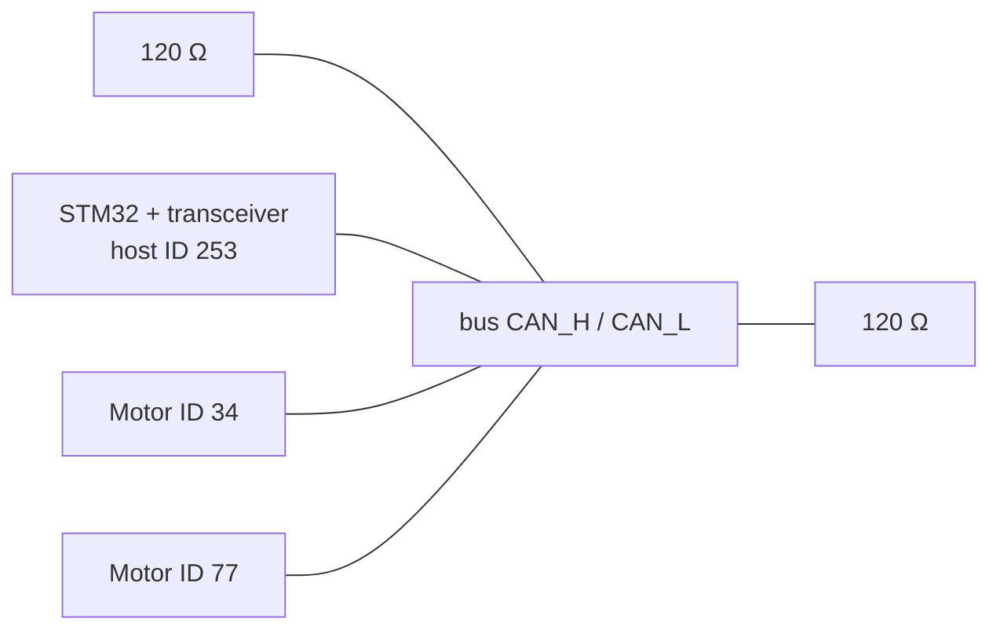
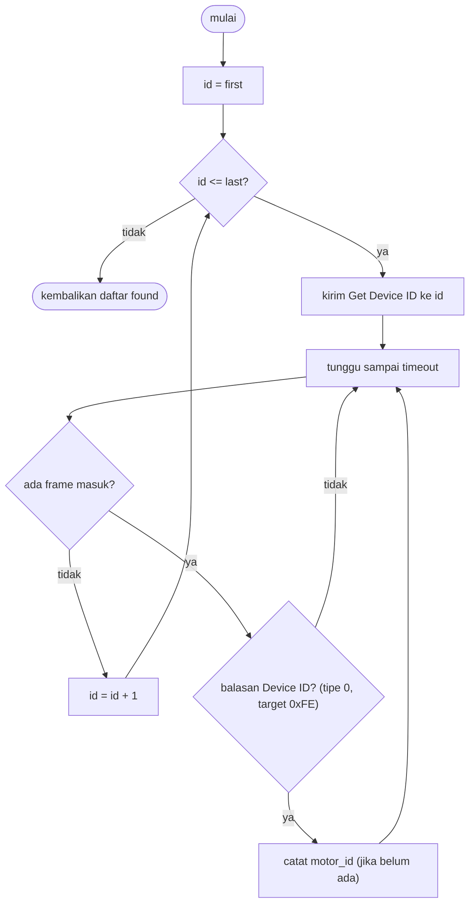

# Level 12: Dua Motor dalam Satu Bus dan Mencari CAN ID

[← Level 11](11-decode-di-library.md) · [Beranda](../README.md) · [Level 13: Mode dan Test Case →](13-mode-test-case.md)

> [!NOTE]
> Level ini langsung menjawab **Demo 4** ("kontrol dua motor dalam satu bus") dan **Demo 5** ("temukan CAN ID motor yang tidak diketahui"). Algoritma scan dibuktikan dulu di laptop dengan **bus tiruan (mock)**, lalu dipasang ke STM32.

## Tujuan belajar

- [ ] Menjelaskan bagaimana dua motor berbagi satu bus tanpa tabrakan
- [ ] Mengontrol dua motor secara independen dari satu STM32
- [ ] Merancang dan mengimplementasikan scan ID memakai Get Device ID
- [ ] Menghindari jebakan loop `uint8_t` dan frame nyasar

**Prasyarat:** Level 7, 10, 11. Folder: `exercises/level-12-scan/`.

---

## 🧠 Konsep

### 1. Dua motor, satu bus



Pada bus yang sama, setiap frame tiba di **semua** node. Yang membedakan penerimanya adalah **ID**:

| Arah | Siapa yang memilih | Caranya |
|---|---|---|
| Host → motor | motor | frame berisi **ID motor** di bit 7..0; motor lain mengabaikan |
| Motor → host | host | feedback berisi **ID motor** di bit 15..8 dan **ID host** di bit 7..0; host memilih struct motor dari ID itu |

Karena itu **tiap motor harus punya ID unik**. Dua motor ber-ID sama membuat balasan saling bertabrakan.

### 2. Aturan fisik untuk dua motor

- Terminasi 120 Ω tetap **hanya di dua ujung bus**. Ukur CANH–CANL lagi: harus ≈ 60 Ω.
- Kedua motor berbagi catu 24 V; naikkan pembatas arus sedikit sesuai kebutuhan, tetapi tetap rendah saat uji awal.
- Percabangan (*stub*) ke tiap node sependek mungkin.
- Checklist keselamatan Level 8 berlaku **untuk setiap motor**.

### 3. Kontrol dua motor dari satu loop

```c
cybergear_add_motor(34);
cybergear_add_motor(77);

while (1) {
    cybergear_send_motion(34, ...);
    cybergear_send_motion(77, ...);
    HAL_Delay(10);                       // 100 Hz
}
```

Dua frame kontrol berurutan memakai 2 dari 3 mailbox kirim; feedback masuk lewat interrupt dan dipilah per ID. Beban bus: sekitar 5% (Level 6D).

> [!WARNING]
> Jangan mengirim lebih dari 3 frame berturut-turut tanpa jeda atau pemeriksaan mailbox. Yang keempat gagal (`HAL_ERROR`). Selalu periksa `HAL_CAN_GetTxMailboxesFreeLevel(&hcan)` atau tangani nilai kembalian.

### 4. Mencari ID motor yang tidak diketahui

Idenya sederhana: **tanyakan ke setiap ID yang mungkin, "kamu ada?"**. Motor yang ada menjawab.



**Berapa ID yang di-scan?** Parameter `CAN_ID` pada manual tercatat dengan batas 127, jadi pindai **0 sampai 127** dulu. Jika tidak ketemu, perluas ke 0..255 (hanya makan waktu beberapa detik lebih lama).

**Berapa lama?** Per ID: satu frame kirim (≈ 131 µs) + satu balasan (≈ 131 µs). Waktu tunggu (mis. 5 ms) mendominasi: 128 ID × 5 ms ≈ **0,64 detik**.

### 5. Empat jebakan scan

> [!WARNING]
> 1. **Loop `uint8_t` tak berujung.** `for (uint8_t id = 0; id <= 255; id++)`: `id <= 255` selalu benar karena 255 + 1 kembali ke 0. Pakai tipe lebih lebar (`uint16_t`/`int`) untuk penghitung.
> 2. **Frame nyasar.** Feedback motor lain bisa lewat saat kamu menunggu. Hanya hitung balasan yang **tipe 0 dan target `0xFE`**.
> 3. **Duplikat.** Satu motor bisa menjawab berkali-kali dalam jendela tunggu; catat sekali saja.
> 4. **Kapasitas.** Jangan menulis melebihi `max_found` pada array hasil.

Jebakan 1, 2, dan 4 diuji otomatis oleh `make test-12`; jebakan 3 (duplikat) kamu jaga sendiri di kodemu.

### 6. Pola transport (persiapan Level 14)

Fungsi `cg_scan` tidak memanggil HAL langsung. Ia menerima **objek transport** berisi tiga fungsi (`send`, `recv`, `now_ms`). Di laptop diisi bus tiruan, di STM32 diisi HAL. Kode scan yang sama berjalan di keduanya.

---

## 🧪 Latihan

### 12A. Rancang di kertas

Gambar ulang diagram alir scan **tanpa melihat** diagram di atas. Lalu hitung: berapa lama scan 0..255 dengan timeout 3 ms per ID?

<details>
<summary>▶ Kunci jawaban</summary>

$256 \times 3\ \text{ms} = 768\ \text{ms}$, sekitar 0,77 detik (waktu di bus sendiri hanya sekitar $256 \times 262\ \mu s \approx 67\ \text{ms}$).

</details>

### 12B. Implementasi `cg_scan` (mock)

Isi `exercises/level-12-scan/cg_scan.c`. Bus tiruan ada di `mockbus.c` (jangan diubah); ia membalas Get Device ID sesuai motor yang "dipasang" di dalamnya, dan bisa menyuntikkan frame nyasar.

```bash
cd exercises && make test-12
```

Uji mencakup: dua motor ditemukan, rentang dibatasi, bus kosong, kapasitas, frame nyasar, rentang sampai 255, dan rentang satu ID.

<details>
<summary>▶ Petunjuk 1: kerangka loop</summary>

```c
for (uint16_t id = first; id <= last; id++) {
    // 1) bangun frame (cg_build_get_device_id) lalu t->send(...)
    // 2) t0 = t->now_ms(t->ctx); selama (now - t0) < timeout_ms:
    //       ambil frame dengan t->recv; jika tidak ada, lanjut menunggu
    //       decode dengan cg_decode_device_id; jika bukan balasan, abaikan
    //       jika motor belum ada di found[] dan n < max_found: simpan
}
```

</details>

<details>
<summary>▶ Petunjuk 2: kenapa <code>now - t0</code> dan bukan perbandingan mutlak?</summary>

Sama seperti Level 2 di proyek sebelumnya: pengurangan unsigned tetap benar walau penghitung waktu meluap.

</details>

<details>
<summary>▶ Petunjuk 3: tes "timeout" tampak menggantung</summary>

Bus tiruan memajukan jam 1 ms setiap kali `now_ms` dibaca, jadi loop tunggu pasti berakhir. Jika tes menggantung lebih dari 5 detik, tes sendiri menghentikan program dan mencetak `FAIL`: periksa tipe penghitung loop (jebakan 1).

</details>

### 12C. Pasang ke STM32

Di library, transport HAL cukup tiga fungsi. Cara termudah untuk pemula adalah **bitmap "sudah terlihat"** yang diisi `handle_device_id` (Level 11):

```c
static uint32_t s_seen[8];                       // satu bit per ID 0..255
static void mark_seen(uint8_t id) { s_seen[id >> 5] |= (1u << (id & 31)); }
static bool was_seen(uint8_t id)  { return (s_seen[id >> 5] >> (id & 31)) & 1u; }
```

Ubah `handle_device_id` agar memanggil `mark_seen(motor)` **sebelum** memeriksa apakah motor terdaftar (supaya ID yang belum terdaftar tetap tercatat). Lalu:

```c
uint8_t cybergear_scan(uint8_t first, uint8_t last, uint8_t *found, uint8_t max_found)
{
    memset(s_seen, 0, sizeof s_seen);
    for (uint16_t id = first; id <= last; id++) {
        // tunggu mailbox kosong (dengan batas waktu)
        cybergear_get_device_id((uint8_t)id);
        uint32_t t0 = HAL_GetTick();
        while (HAL_GetTick() - t0 < 5) { /* interrupt mengisi s_seen */ }
    }
    uint8_t n = 0;
    for (uint16_t id = first; id <= last && n < max_found; id++)
        if (was_seen((uint8_t)id)) found[n++] = (uint8_t)id;
    return n;
}
```

> [!NOTE]
> Versi ini *blocking* selama scan (sekitar 0,6 detik), dan itu wajar untuk fase inisialisasi. Menjadikannya non-blocking (state machine) adalah tantangan lanjutan.

### 12D. Uji di motor

1. **Satu motor** (ID yang kamu ketahui): scan 0..127. Hasil harus tepat satu ID yang cocok.
2. **Dua motor**: hasil harus dua ID.
3. **Motor "tidak dikenal"**: minta teman menutup label atau mengubah ID motor ke nilai acak (Level 10, dengan izin dan satu motor saja). Scan, temukan, lalu `add_motor` dan `enable` ID yang ditemukan.

**Hasil yang diharapkan:** ID ditemukan kurang dari 1 detik.

<details>
<summary>▶ Petunjuk: scan tidak menemukan apa pun</summary>

Urutan diagnosa: (1) `hcan.Instance->ESR`: LEC = 3 berarti belum ada ACK (daya/kabel); (2) `rx_count` naik? Jika tidak, tidak ada balasan sama sekali; (3) apakah `handle_device_id` membuang balasan karena pemeriksaan host (Level 11)? (4) perlebar rentang ke 0..255.

</details>

### 12E. Kontrol dua motor

Dengan **keselamatan penuh** (kedua motor dijepit):

| Langkah | Hasil yang diharapkan |
|---|---|
| `add_motor` untuk dua ID, `enable` keduanya | kedua `online = true`, `mode = 2` |
| Motor A: perintah gerak lambat (Kp kecil); motor B: diam (Kp = 0) | hanya A bergerak |
| Tukar peran | hanya B bergerak |
| Baca `temperature` kedua motor | dua nilai berbeda, wajar |
| `disable` keduanya | `mode = 0` |

Pantau `position` kedua motor di Live Expressions: A berubah, B hampir tetap.

### 12F. Skrip penjelasan demo

Tuliskan 4 kalimat tentang bagaimana kamu menemukan ID tak dikenal, termasuk **kenapa Get Device ID** dipilih, **kenapa rentang 0..127**, dan **bagaimana frame nyasar ditangani**.

---

## ✅ Checkpoint: lulus jika

- [ ] `make test-12` menampilkan `SEMUA LOLOS`
- [ ] Scan di motor nyata menemukan ID yang benar
- [ ] Dua motor dikendalikan independen
- [ ] Kamu bisa menjelaskan keempat jebakan scan

## ❓ Cek pemahaman

**1.** Kenapa dua motor ber-ID sama tidak boleh berada di satu bus?

**2.** Apa isi ExtId balasan Get Device ID dari motor 77?

**3.** Kenapa loop `for (uint8_t id = 0; id <= 255; id++)` tak pernah berhenti?

**4.** Kenapa pemeriksaan `host == s_host_id` tidak boleh dipakai untuk balasan Device ID?

<details>
<summary>▶ Kunci jawaban (tulis jawabanmu dulu)</summary>

1. Keduanya menjawab perintah yang sama dan frame balasannya bertabrakan; host tidak bisa membedakan, dan perintah mengenai keduanya sekaligus.
2. `0x00004DFE` (77 = `0x4D`; motor di bit 15..8, `0xFE` di bit 7..0).
3. `uint8_t` maksimum 255; `255 + 1` meluap menjadi 0 sehingga `id <= 255` selalu benar.
4. Balasan Device ID bertarget `0xFE`, bukan ID host, sehingga pemeriksaan itu akan membuangnya.

</details>

---

[← Level 11](11-decode-di-library.md) · [Beranda](../README.md) · [Level 13: Mode dan Test Case →](13-mode-test-case.md)
