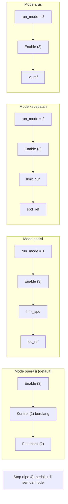

# Level 13: Mode Kontrol dan Menghadapi Test Case Penguji

[← Level 12](12-dua-motor-scan.md) · [Beranda](../README.md) · [Level 14: OOP →](14-oop.md)

> [!NOTE]
> Tujuan level ini: menguasai **empat mode kontrol** motor dan menyiapkan diri untuk **test case dari penguji** (Demo 3), yang isinya tidak kamu ketahui sebelumnya. Kuncinya bukan menghafal skenario, tetapi punya **alat uji fleksibel** dan paham urutan perintah tiap mode.

## Tujuan belajar

- [ ] Menjelaskan empat mode (operasi/MIT, posisi, kecepatan, arus) dan urutan perintahnya
- [ ] Mengirim urutan yang benar untuk tiap mode
- [ ] Membuat *test runner* yang bisa dipicu dari debugger
- [ ] Menangani kondisi gagal (motor hilang, fault, stop darurat)

**Prasyarat:** Level 10, 11, 12.

---

## 🧠 Konsep

### 1. Empat mode

Setelah daya menyala, motor berada pada **mode kontrol operasi** secara default. Mode lain dipilih dengan **menulis parameter `run_mode` (0x7005)** *sebelum* enable.

| Mode | `run_mode` | Yang kamu perintahkan | Cocok untuk |
|---|:-:|---|---|
| Kontrol operasi (MIT) | 0 | posisi, kecepatan, torsi, Kp, Kd (frame tipe 1) | gerak lembut dengan kekakuan diatur |
| **Posisi** | 1 | `loc_ref` (rad), batas `limit_spd` | "pergi ke sudut X" |
| **Kecepatan** | 2 | `spd_ref` (rad/s), batas `limit_cur` | "putar dengan kecepatan Y" |
| **Arus** | 3 | `iq_ref` (A) | kontrol torsi langsung |

### 2. Urutan perintah (dari manual, §4.2)



> [!IMPORTANT]
> Urutan itu penting. `run_mode` ditulis **sebelum** enable; batas (`limit_spd` atau `limit_cur`) ditulis **sebelum** referensi gerak, supaya motor tidak bergerak dengan batas default yang mungkin tinggi.

### 3. Frame untuk mode kecepatan (host 253, motor 34)

| Langkah | ExtId | Data (8 byte) |
|---|---|---|
| 1. `run_mode = 2` | `0x1200FD22` | `05 70 00 00 02 00 00 00` |
| 2. Enable | `0x0300FD22` | `00 00 00 00 00 00 00 00` |
| 3. `limit_cur = 2.0` | `0x1200FD22` | `18 70 00 00 00 00 00 40` |
| 4. `spd_ref = 3.0` | `0x1200FD22` | `0A 70 00 00 00 00 40 40` |
| 5. Stop | `0x0400FD22` | semua nol |

Cek: `2.0f` = `0x40000000` → little-endian `00 00 00 40`; `3.0f` = `0x40400000` → `00 00 40 40`.

**Mode posisi:** `run_mode = 1`, enable, `limit_spd = 2.0` (`17 70 00 00 00 00 00 40`), `loc_ref = 1.5` (`16 70 00 00 00 00 C0 3F`).
**Mode arus:** `run_mode = 3` (`05 70 00 00 03 ...`), enable, `iq_ref = 0.5` (`06 70 00 00 00 00 00 3F`).

### 4. Hukum kontrol mode operasi (MIT)

Pada mode operasi, motor menghitung torsi dari lima nilai yang kamu kirim:

$$ \tau = K_p\,(\theta_{ref} - \theta) + K_d\,(\omega_{ref} - \omega) + \tau_{ff} $$

| Suku | Arti |
|---|---|
| $K_p(\theta_{ref} - \theta)$ | seperti **pegas**: makin jauh dari target, makin kuat tarikan |
| $K_d(\omega_{ref} - \omega)$ | seperti **peredam**: melawan selisih kecepatan, mencegah osilasi |
| $\tau_{ff}$ | torsi tambahan langsung (*feed-forward*) |

Maka: **Kp = 0 dan Kd = 0 membuat torsi hanya dari $\tau_{ff}$** (motor "lemas" kalau $\tau_{ff} = 0$). Itu sebabnya uji awal selalu dengan Kp = Kd = 0.

> [!NOTE]
> Rumus ini adalah bentuk umum kontrol operasi (gaya MIT mini-cheetah). Pastikan kamu mencocokkannya dengan bagian mode operasi di manual yang kamu pegang sebelum menyebutnya sebagai fakta di demo.

> [!WARNING]
> **Ketidakkonsistenan manual yang perlu kamu tahu:** tabel protokol menyebut rentang posisi −4π..4π (±12,566 rad), tetapi contoh kode di manual memakai `P_MIN = -12.5`, `P_MAX = 12.5`. Perbedaannya ±0,5%. Library yang diberikan memakai ±4π, sesuai tabel. Jika posisi yang kamu perintahkan dan yang terukur berbeda sekitar 0,5%, inilah kemungkinan sebabnya; **uji di motor** dan tuliskan keputusanmu.

---

## 🧪 Latihan

### 13A. Hitung urutan di kertas

Mode **posisi**, motor 7, host 253: tulis kelima frame (run_mode, enable, limit_spd = 3.0, loc_ref = 0.5, stop) lengkap dengan ExtId dan data.

<details>
<summary>▶ Petunjuk</summary>

`3.0f` = `00 00 40 40` (LE); `0.5f` = `0x3F000000` → `00 00 00 3F`. Index `limit_spd` `0x7017` → `17 70`; `loc_ref` `0x7016` → `16 70`. Motor 7 = `0x07`, jadi ExtId berakhiran `FD07`.

</details>

<details>
<summary>▶ Kunci jawaban</summary>

| Langkah | ExtId | Data |
|---|---|---|
| run_mode = 1 | `0x1200FD07` | `05 70 00 00 01 00 00 00` |
| Enable | `0x0300FD07` | nol |
| limit_spd = 3.0 | `0x1200FD07` | `17 70 00 00 00 00 40 40` |
| loc_ref = 0.5 | `0x1200FD07` | `16 70 00 00 00 00 00 3F` |
| Stop | `0x0400FD07` | nol |

</details>

### 13B. Fungsi tingkat tinggi

Di library, tambahkan fungsi yang mengirim **urutan lengkap** sehingga aplikasi tidak perlu mengingat urutannya:

```c
HAL_StatusTypeDef cybergear_mode_speed   (uint8_t id, float limit_cur, float spd_ref);
HAL_StatusTypeDef cybergear_mode_position(uint8_t id, float limit_spd, float loc_ref);
HAL_StatusTypeDef cybergear_mode_current (uint8_t id, float iq_ref);
```

Kerangka satu fungsi:

```c
HAL_StatusTypeDef cybergear_mode_speed(uint8_t id, float limit_cur, float spd_ref)
{
    HAL_StatusTypeDef st;
    st = cybergear_set_run_mode(id, 2);                         if (st != HAL_OK) return st;
    st = cybergear_enable(id);                                  if (st != HAL_OK) return st;
    st = cybergear_param_write_f32(id, CG_PARAM_LIMIT_CUR, limit_cur);  if (st != HAL_OK) return st;
    return cybergear_param_write_f32(id, CG_PARAM_SPD_REF, spd_ref);
}
```

> [!WARNING]
> Empat frame berturut-turut bisa menghabiskan 3 mailbox. Sisipkan jeda singkat (mis. 2 ms) atau tunggu `HAL_CAN_GetTxMailboxesFreeLevel` kembali. Tangani nilai `HAL_ERROR`.

### 13C. Uji tiap mode di motor

Dengan **keselamatan penuh** dan batas rendah:

| Mode | Uji | Hasil yang diharapkan |
|---|---|---|
| Kecepatan | `limit_cur = 1.0`, `spd_ref = 2.0` selama 3 detik, lalu stop | poros berputar ±2 rad/s; `velocity` feedback mendekati 2 |
| Posisi | `limit_spd = 1.0`, `loc_ref = +1.0` lalu `-1.0` | poros pergi ke sudut itu; `position` feedback mengikuti |
| Arus | `iq_ref = 0.3` singkat | poros berputar/menahan ringan (torsi kecil) |
| MIT | `Kp = 1`, `Kd = 0.1`, target posisi kecil | poros menahan posisi seperti pegas |

> [!CAUTION]
> Nilai di atas adalah **contoh awal yang konservatif**. Sesuaikan dengan bimbingan asisten, jangan menaikkan sekaligus, dan selalu siapkan **Stop**.

### 13D. *Test runner* yang bisa dipicu dari debugger

Penguji akan meminta skenario yang tidak kamu tahu. Buat alat yang fleksibel: variabel global yang bisa diubah **langsung di Live Expressions** saat Debug berjalan.

```c
volatile uint8_t  cmd = 0;            // ubah di Live Expressions
volatile float    arg1 = 0, arg2 = 0;
volatile uint8_t  target_id = 34;

void run_command(void)
{
    switch (cmd) {
    case 1:  cybergear_enable(target_id);                       break;
    case 2:  cybergear_disable(target_id);                      break;
    case 3:  cybergear_set_zero(target_id);                     break;
    case 4:  cybergear_clear_fault(target_id);                  break;
    case 5:  cybergear_mode_speed(target_id, 1.0f, arg1);       break;
    case 6:  cybergear_mode_position(target_id, 1.0f, arg1);    break;
    case 7:  /* scan dan cetak hasil */                         break;
    default: break;
    }
    cmd = 0;                          // jalankan sekali
}
```

Panggil `run_command()` di loop utama. Saat penguji berkata "putar 5 rad/s", kamu cukup mengisi `arg1 = 5` dan `cmd = 5` di debugger.

**Tantangan:** tambahkan `cmd` untuk membaca suhu dan fault dan menampilkannya (Live Expressions pada struct motor sudah cukup).

### 13E. Tombol "stop darurat" di perangkat lunak

Tambahkan satu `cmd` khusus (mis. `99`) atau tombol fisik di PA0 yang **langsung mengirim Disable ke semua motor terdaftar**. Pastikan jalur ini **tidak** menunggu apa pun.

### 13F. Kondisi gagal

| Skenario | Cara mensimulasikan | Respons yang baik |
|---|---|---|
| Motor hilang dari bus | cabut CANH atau daya motor | `last_rx_ms` tidak maju → tandai `online = false` setelah timeout (mis. 100 ms) |
| Fault muncul | injeksi frame (Level 11C) | `is_error = true`; hentikan perintah gerak |
| `HAL_CAN_AddTxMessage` gagal | kirim banyak frame beruntun | hitung kegagalan, jangan diam |

Tambahkan fungsi `bool cybergear_is_online(uint8_t id, uint32_t timeout_ms)` yang membandingkan `HAL_GetTick() - last_rx_ms` dengan `timeout_ms`.

### 13G. Latihan berpura-pura jadi penguji

Tulis sepuluh test case yang mungkin diberikan penguji (mis. "enable lalu baca suhu", "ke posisi 1 rad lalu kembali", "putar 3 detik lalu stop", "set zero lalu bergerak relatif", "baca fault setelah clear"). Untuk tiap kasus, tulis urutan `cmd`-nya dan hasil yang diharapkan. Latih dengan temanmu sebagai penguji.

---

## ✅ Checkpoint: lulus jika

- [ ] Kamu bisa menuliskan urutan perintah tiap mode tanpa melihat catatan
- [ ] Setidaknya mode kecepatan dan posisi teruji di motor
- [ ] *Test runner* berfungsi dan stop darurat tidak terhalang apa pun
- [ ] Kamu bisa menjelaskan arti Kp, Kd, dan torsi feed-forward

## ❓ Cek pemahaman

**1.** Kenapa `limit_cur` ditulis sebelum `spd_ref` pada mode kecepatan?

**2.** Dalam mode operasi dengan Kp = 0, Kd = 0, torsi = 0, apa yang terjadi pada poros?

**3.** Perintah apa yang menghentikan motor di semua mode?

**4.** Apa kemungkinan penyebab bila posisi terukur berbeda sekitar 0,5% dari yang diperintahkan?

<details>
<summary>▶ Kunci jawaban (tulis jawabanmu dulu)</summary>

1. Supaya motor tidak bergerak dengan batas arus default yang mungkin tinggi begitu `spd_ref` diterima.
2. Torsi nol sehingga poros "lemas" (bergerak bebas jika diputar tangan).
3. Frame Stop (tipe 4).
4. Perbedaan rentang posisi: tabel protokol memakai ±4π, sedangkan contoh kode manual memakai ±12,5.

</details>

---

[← Level 12](12-dua-motor-scan.md) · [Beranda](../README.md) · [Level 14: OOP →](14-oop.md)
