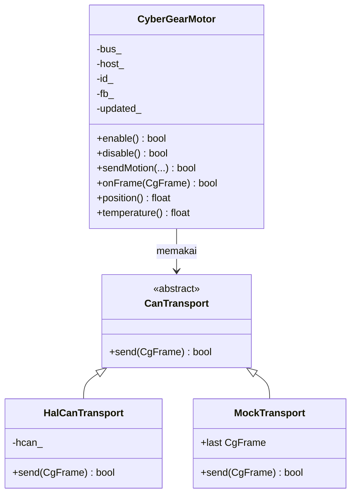

# Level 14: Mengubah Driver Menjadi OOP dengan C++ (Tugas 2)

[← Level 13](13-mode-test-case.md) · [Beranda](../README.md) · [Level 15: Baremetal →](15-baremetal.md)

> [!NOTE]
> Tujuan level ini: memindahkan driver dari **gaya fungsi** (variabel global + fungsi `cybergear_*`) ke **gaya objek** (satu objek per motor, satu objek untuk transport), sesuai konsep di Modul 3 OOP C++. Ini nilai plus di penugasan, dan latihan terbaik tentang *kenapa* OOP berguna.

## Tujuan belajar

- [ ] Memetakan konsep C (struct + fungsi) ke C++ (class + method)
- [ ] Memakai constructor, `private`/`public`, getter, dan `const`
- [ ] Memakai abstraksi (kelas abstrak) dan polimorfisme untuk memisahkan transport
- [ ] Mengintegrasikan C++ ke project STM32CubeIDE tanpa merusak kode C
- [ ] Menjelaskan "kenapa OOP" dan biayanya

**Prasyarat:** Level 5, 7, 10, 11. Folder: `exercises/level-14-oop/`. Latihan memakai hasil Level 2–4, 7, 10 milikmu.

---

## 🧠 Konsep

### 1. Kenapa OOP untuk driver ini

Pada library yang diberikan, semuanya dibagi lewat **variabel global tersembunyi**: `s_hcan`, `s_host_id`, array `s_motors[]`. Konsekuensinya:

| Masalah gaya fungsi | Bagaimana OOP membantu |
|---|---|
| Hanya **satu** bus dan satu host ID di seluruh program | tiap objek membawa konfigurasinya sendiri |
| Fungsi menerima `motor_id` di setiap panggilan, mudah salah ID | objek `motor34` sudah "tahu" ID-nya |
| Sulit diuji tanpa hardware (bergantung HAL) | transport disuntikkan; diuji dengan transport tiruan |
| Data motor bisa diubah dari mana saja | atribut `private`, akses lewat method |

### 2. Pemetaan C → C++ (Modul 3)

| Di versi fungsi | Di versi OOP |
|---|---|
| `struct CG_Motor` + `cybergear_*(id, ...)` | `class CyberGearMotor` dengan atribut `private` dan method `enable()`, `sendMotion()`, ... |
| `static CAN_HandleTypeDef *s_hcan` | kelas abstrak `CanTransport` + turunan `HalCanTransport` |
| `cybergear_init(hcan, host)` | **constructor** `CyberGearMotor(bus, host, id)` |
| `cybergear_get_motor(id)` + `rx_handler` | method `onFrame(frame)`; pemilihan motor dilakukan pemanggil/bus |
| `m->position` | getter `position()` (`const`) |

### 3. Rancangan kelas



Hubungannya dijelaskan lewat konsep di Modul 3:

| Konsep OOP | Di rancangan ini |
|---|---|
| **Class dan object** | `CyberGearMotor` adalah cetakan; `m34` dan `m77` adalah dua objek |
| **Atribut** | `host_`, `id_`, `fb_`, `updated_` |
| **Method** | `enable()`, `onFrame()`, ... |
| **Constructor** | `CyberGearMotor(bus, host, id)` mengisi atribut |
| **Encapsulation / access modifier** | atribut `private`, hanya method `public` yang boleh mengubahnya |
| **Getter** | `position()`, `temperature()` (ditandai `const`) |
| **Abstraction** | `CanTransport` hanya berjanji "bisa `send`", tanpa peduli HAL atau mock |
| **Inheritance** | `HalCanTransport : public CanTransport` |
| **Polymorphism** | `bus_.send(f)` memanggil versi yang tepat (HAL atau mock) saat program berjalan |

### 4. Potongan C++ yang perlu kamu pahami

```cpp
class CanTransport {
public:
    virtual ~CanTransport() {}
    virtual bool send(const CgFrame &f) = 0;   // "= 0": pure virtual, wajib diisi turunan
};

class CyberGearMotor {
public:
    CyberGearMotor(CanTransport &bus, uint8_t hostId, uint8_t motorId);
    bool  enable();
    float temperature() const;                  // const: tidak mengubah objek
private:
    CanTransport &bus_;                         // referensi: dipakai, tidak dimiliki
    uint8_t       id_;
};

// daftar inisialisasi: mengisi atribut SEBELUM badan constructor berjalan
CyberGearMotor::CyberGearMotor(CanTransport &bus, uint8_t h, uint8_t m)
    : bus_(bus), host_(h), id_(m), updated_(false) { /* ... */ }
```

| Sintaks | Arti |
|---|---|
| `CanTransport &bus` | **referensi**: nama lain untuk objek yang sama (tidak disalin) |
| `virtual ... = 0` | kontrak: turunan **harus** menyediakan isinya |
| `: bus_(bus), ...` | *member initializer list* |
| `const` di akhir method | method tidak mengubah atribut objek |
| `override` (C++11) | kompiler mengecek kamu benar-benar menimpa method dasar |

### 5. C++ di dalam project CubeIDE

Project P5 berbahasa C. Cara paling aman menambahkan C++:

1. Klik kanan project → **New → Convert to C++** (supaya `g++` dipakai untuk file `.cpp`).
2. **Biarkan `main.c` tetap C.** Buat `app.cpp` berisi fungsi `extern "C" void app_main(void)` dan panggil dari `main.c` di blok `USER CODE 2`/`WHILE`.
3. Callback HAL yang dipanggil dari C (`HAL_CAN_RxFifo0MsgPendingCallback`) harus berlabel `extern "C"`.
4. **Objek dibuat statis/global**, jangan `new` (tidak ada heap yang terjamin di MCU kecil).

```cpp
// app.cpp
extern "C" {
#include "main.h"
}
#include "cg_motor.hpp"

static HalCanTransport g_bus(&hcan);
static CyberGearMotor  g_m34(g_bus, 253, 34);

extern "C" void app_main(void)      { /* dipanggil dari main.c */ }

extern "C" void HAL_CAN_RxFifo0MsgPendingCallback(CAN_HandleTypeDef *h)
{
    /* GetRxMessage -> CgFrame -> g_m34.onFrame(frame) */
}
```

> [!WARNING]
> Header C yang dipanggil dari C++ harus dibungkus `extern "C" { ... }` (header HAL sudah punya). Tanpa itu, penaut mencari nama yang "dihias" C++ dan gagal. Di latihan, header `cg_*.h` sudah punya penjaga `#ifdef __cplusplus`.

### 6. Biayanya

| Hal | Dampak |
|---|---|
| Fungsi virtual | satu pointer tabel per objek dan satu lompatan tidak langsung: nyaris tak terasa untuk 100 Hz |
| Ukuran kode | bisa naik sedikit; matikan eksepsi/RTTI (`-fno-exceptions -fno-rtti`) |
| RAM (20 KB di F103C8) | objek kecil; cukup dengan alokasi statis |

---

## 🧪 Latihan

### 14A. Pemetaan di kertas

Tanpa melihat tabel, gambar ulang rancangan kelas (nama kelas, atribut, method) dan beri label konsep OOP-nya (constructor, encapsulation, abstraction, polymorphism). Cocokkan dengan §3.

### 14B. Implementasi `CyberGearMotor` (laptop)

Isi `exercises/level-14-oop/cg_motor.cpp`. File `cg_motor.hpp` dan `test_motor.cpp` (transport tiruan) sudah disediakan.

```bash
cd exercises && make test-14
```

Uji mencakup: dua objek dengan ID berbeda berbagi satu bus, isi frame benar, hasil `send` diteruskan, frame motor lain **ditolak**, getter bekerja, dan polimorfisme lewat referensi `CanTransport&`.

<details>
<summary>▶ Petunjuk 1: perintah sederhana</summary>

Pola semua perintah sama: `CgFrame f; cg_build_xxx(&f, host_, id_, ...); return bus_.send(f);`. Ingat `cg_build_motion` tidak butuh `host`.

</details>

<details>
<summary>▶ Petunjuk 2: <code>onFrame</code></summary>

Decode dulu ke `CgFeedback` **sementara** (`tmp`). Jika gagal, atau `tmp.motor_id != id_`, `return false` **tanpa menyentuh `fb_`**. Hanya kalau lolos: `fb_ = tmp; updated_ = true; return true;`.

</details>

<details>
<summary>▶ Petunjuk 3: kenapa decode ke variabel sementara dulu?</summary>

Supaya frame motor lain atau frame rusak tidak menimpa data motor ini setengah jalan. Ini disebut *validasi sebelum komit*.

</details>

### 14C. `HalCanTransport` untuk STM32

Tulis kelas turunan di project CubeIDE:

```cpp
class HalCanTransport : public CanTransport {
public:
    explicit HalCanTransport(CAN_HandleTypeDef *h) : hcan_(h) {}
    bool send(const CgFrame &f) override {
        CAN_TxHeaderTypeDef th;
        th.StdId = 0;  th.ExtId = f.ext_id;
        th.IDE = CAN_ID_EXT;  th.RTR = CAN_RTR_DATA;
        th.DLC = f.dlc;       th.TransmitGlobalTime = DISABLE;
        uint32_t mb;
        return HAL_CAN_AddTxMessage(hcan_, &th, const_cast<uint8_t *>(f.data), &mb) == HAL_OK;
    }
private:
    CAN_HandleTypeDef *hcan_;
};
```

`const_cast` dipakai karena beberapa versi HAL mendeklarasikan parameter data tanpa `const`. Kenapa `HalCanTransport` tidak perlu tahu apa pun tentang motor?

### 14D. Penerimaan frame dan dua motor

Di callback RX: `HAL_CAN_GetRxMessage` → isi `CgFrame` → panggil `onFrame` pada **setiap** objek motor (masing-masing menolak yang bukan miliknya):

```cpp
CgFrame f;  f.ext_id = rh.ExtId;  f.dlc = rh.DLC;  memcpy(f.data, d, 8);
g_m34.onFrame(f);
g_m77.onFrame(f);
```

Uji dengan dua motor (Level 12E): kedua objek punya `temperature()` masing-masing.

### 14E. (Tantangan) `CyberGearBus`

Buat kelas yang menyimpan hingga 8 pointer motor (`attach(CyberGearMotor&)`) dan method `dispatch(const CgFrame&)` yang meneruskan ke semua. Callback RX cukup memanggil `bus.dispatch(f)`. Apa keuntungannya dibanding memanggil `onFrame` satu per satu?

### 14F. Menjawab "kenapa OOP?"

Tulis lima kalimat jawaban untuk penguji: dua keuntungan konkret di driver ini (bukan teori umum), satu biaya, dan satu contoh bug yang dicegah (mis. salah ID pada setiap panggilan).

---

## ✅ Checkpoint: lulus jika

- [ ] `make test-14` menampilkan `SEMUA LOLOS`
- [ ] Versi class berjalan di STM32 mengendalikan motor
- [ ] Kamu bisa menjelaskan abstraksi `CanTransport` dan polimorfisme dengan contoh dari kodemu
- [ ] Tabel pemetaan C → C++ bisa kamu gambar dari ingatan

## ❓ Cek pemahaman

**1.** Apa bedanya `.` dan `->` untuk objek C++ dan pointer ke objek?

**2.** Kenapa atribut dibuat `private`?

**3.** Apa arti `= 0` pada `virtual bool send(...) = 0;`?

**4.** Kenapa kita tidak memakai `new` untuk membuat objek motor di MCU?

<details>
<summary>▶ Kunci jawaban (tulis jawabanmu dulu)</summary>

1. `.` untuk objek itu sendiri (`m.enable()`), `->` untuk pointer ke objek (`p->enable()`). Sama seperti struct di Level 5.
2. Supaya status motor hanya berubah lewat method yang memvalidasi; kode lain tidak bisa merusaknya.
3. Method *pure virtual*: kelas dasar tidak punya isinya, turunan **wajib** menyediakan; kelas itu menjadi abstrak dan tidak bisa dibuat objeknya langsung.
4. Heap di MCU kecil terbatas dan tidak dapat diprediksi; alokasi statis memastikan memori cukup sejak waktu kompilasi.

</details>

---

[← Level 13](13-mode-test-case.md) · [Beranda](../README.md) · [Level 15: Baremetal →](15-baremetal.md)
