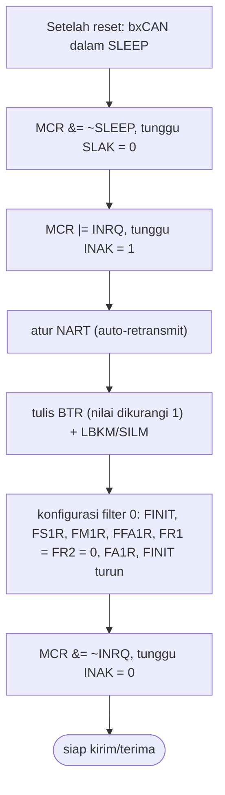
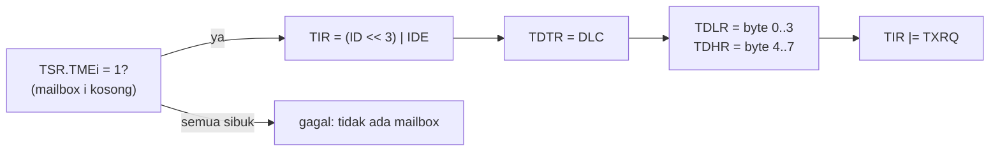

# Level 15: Library Baremetal bxCAN (Tugas 3, Poin A+)

[← Level 14](14-oop.md) · [Beranda](../README.md) · [Level 16: Persiapan Demo →](16-persiapan-demo.md)

> [!NOTE]
> Tujuan level ini: mengendalikan CAN **langsung lewat register** tanpa HAL. Kamu akan memahami apa yang sebenarnya dilakukan `HAL_CAN_*`. Logika register dibuktikan dulu di laptop memakai **memori palsu**, lalu dipasang di STM32.

## Tujuan belajar

- [ ] Menjelaskan arti "baremetal" dan kapan layak dipakai
- [ ] Membaca peta register bxCAN dari reference manual (RM0008)
- [ ] Mengimplementasikan init, kirim, dan terima di tingkat register
- [ ] Menguji logika register tanpa hardware (hook "hardware palsu")
- [ ] Mengintegrasikan ke driver CyberGear dan membandingkan dengan versi HAL

**Prasyarat:** Level 1 (bitwise), 2, 6 (bit timing), 8. Folder: `exercises/level-15-bxcan/`.

---

## 🧠 Konsep

### 1. Apa itu baremetal

Baremetal berarti program berbicara **langsung dengan register hardware**, tanpa lapisan library (HAL). Register adalah alamat memori khusus; menulis ke sana mengubah perilaku periferal (Modul 4, *memory-mapped I/O*).

| | HAL | Baremetal |
|---|---|---|
| Kode yang kamu tulis | memanggil `HAL_CAN_Start(...)` | menulis `CAN->MCR &= ~INRQ` |
| Ukuran kode | lebih besar | lebih kecil |
| Kecepatan belajar | cepat | lambat, tetapi memahami hardware |
| Kontrol | dibatasi cara HAL bekerja | penuh |
| Risiko | rendah | satu bit salah = tidak berfungsi |

**Pasangan yang berguna:** setiap fungsi HAL yang kamu pakai selama ini punya padanan register.

| HAL | Padanan register |
|---|---|
| `HAL_CAN_Init` | keluar dari sleep, masuk INRQ, atur BTR dan MCR |
| `HAL_CAN_ConfigFilter` | FMR, FA1R, FS1R, FM1R, FFA1R, F0R1, F0R2 |
| `HAL_CAN_Start` | MCR: bersihkan INRQ, tunggu INAK = 0 |
| `HAL_CAN_AddTxMessage` | cari mailbox TME, tulis TIxR/TDTxR/TDLxR/TDHxR, set TXRQ |
| `HAL_CAN_GetRxMessage` | baca RIxR/RDTxR/RDLxR/RDHxR, set RFOM0 |
| `HAL_CAN_ActivateNotification` | IER |

### 2. Peta register (RM0008)

Basis CAN1: `0x40006400`. Struct di `bxcan_regs.h` meniru urutan ini dan **memeriksa offset saat kompilasi** (`_Static_assert`).

| Offset | Register | Fungsi |
|---:|---|---|
| 0x000 | MCR | kontrol utama: INRQ, SLEEP, NART, ... |
| 0x004 | MSR | status: INAK, SLAK, ... |
| 0x008 | TSR | status kirim: TME0..2 (mailbox kosong) |
| 0x00C | RF0R | FIFO0: FMP0 (jumlah pesan), RFOM0 (lepaskan) |
| 0x014 | IER | enable interrupt: FMPIE0 |
| 0x018 | ESR | error: LEC, TEC, REC, BOFF |
| 0x01C | BTR | bit timing + mode loopback/silent |
| 0x180 + 0x10·i | TIxR, TDTxR, TDLxR, TDHxR | mailbox kirim i = 0..2 |
| 0x1B0 | RI0R, RDT0R, RDL0R, RDH0R | mailbox terima FIFO0 |
| 0x200 | FMR | filter master: FINIT |
| 0x204 / 0x20C / 0x214 / 0x21C | FM1R / FS1R / FFA1R / FA1R | mode, skala, FIFO, aktivasi filter |
| 0x240 + 8·n | FnR1, FnR2 | register filter bank n |

### 3. Urutan inisialisasi



**BTR** (dari Level 6): `BRP = prescaler − 1`, `TS1 = BS1 − 1`, `TS2 = BS2 − 1`, `SJW = SJW − 1`.

$$ \text{BTR} = (TS2 \ll 20) \,|\, (TS1 \ll 16) \,|\, BRP \quad\Rightarrow\quad (1 \ll 20) \,|\, (5 \ll 16) \,|\, 3 = \texttt{0x00150003} $$

(untuk 1 Mbps: prescaler 4, BS1 6, BS2 2, SJW 1). Mode loopback menyalakan bit 30 → `0x40150003`.

### 4. Mengirim



- ID Extended 29 bit disimpan **digeser kiri 3** (bit 31..3 = ID, bit 2 = IDE, bit 1 = RTR, bit 0 = TXRQ).
- `TXRQ` diset **terakhir**; setelah itu perangkat keras mengirim.
- Byte 0 berada di **bit terendah** TDLR (`TDLR = d0 | d1<<8 | d2<<16 | d3<<24`).

**Contoh:** ID `0x0300FD22`: `TIR = (0x0300FD22 << 3) | IDE | TXRQ = 0x1807E910 | 0x4 | 0x1 = 0x1807E915`.

### 5. Menerima

1. Cek `RF0R & FMP0`: jika 0, tidak ada pesan.
2. Baca `RI0R` (ID = `RIR >> 3` bila IDE = 1), `RDT0R & 0xF` (DLC), `RDL0R`, `RDH0R`.
3. **Lepaskan pesan:** `RF0R |= RFOM0`. Tanpa langkah ini FIFO tidak maju dan pesan berikutnya tidak pernah terbaca.

### 6. Hardware yang tidak bisa diuji di laptop

Bagian ini hanya bisa dicoba di STM32, jadi dijelaskan terpisah:

| Langkah | Register |
|---|---|
| Nyalakan clock GPIOA dan AFIO | `RCC->APB2ENR \|= IOPAEN (bit 2) \| AFIOEN (bit 0)` |
| Nyalakan clock CAN1 | `RCC->APB1ENR \|= CAN1EN (bit 25)` |
| PA11 = input *floating* | `GPIOA->CRH`: bit 15..12 = `0100` |
| PA12 = *alternate function push-pull* 50 MHz | `GPIOA->CRH`: bit 19..16 = `1011` |
| Aktifkan interrupt RX0 di NVIC | `NVIC_EnableIRQ(USB_LP_CAN1_RX0_IRQn)` (nomor 20) |
| ISR | `void USB_LP_CAN1_RX0_IRQHandler(void)` |

```c
// PA11 (CAN_RX) dan PA12 (CAN_TX) pada CRH (pin 8..15, 4 bit per pin)
GPIOA->CRH = (GPIOA->CRH & ~((0xFu << 12) | (0xFu << 16)))
           | (0x4u << 12)      // PA11: CNF=01 (floating input), MODE=00
           | (0xBu << 16);     // PA12: CNF=10 (AF push-pull),   MODE=11 (50 MHz)
```

> [!WARNING]
> Clock APB1 harus **36 MHz** agar `BTR` di atas menghasilkan 1 Mbps. Jika kamu hanya mengganti HAL CAN tetapi tetap memakai `SystemClock_Config()` bawaan CubeMX untuk clock, itu sah; menulis RCC sendiri adalah tantangan opsional (15F). Jika proyek memakai ISR bawaan HAL untuk `USB_LP_CAN1_RX0`, hapus atau nonaktifkan agar tidak terjadi definisi ganda.

### 7. Trik uji: "hardware palsu"

Di laptop tidak ada register asli. Fungsi menerima **pointer** `BxCan *can`, sehingga tes menunjuk ke variabel biasa. Beberapa register bereaksi pada hardware asli (mis. `INAK` naik saat `INRQ` diset); tes memakai fungsi `bx_wait_hook` untuk meniru reaksi itu. Hasilnya, kamu bisa menguji **urutan dan nilai register** tanpa board.

---

## 🧪 Latihan

### 15A. Hitung di kertas

1. `BTR` untuk **500 kbps** (prescaler 8, BS1 6, BS2 2, SJW 1).
2. `BTR` untuk **1 Mbps** dengan prescaler 2 (18 tq: BS1 13, BS2 4).
3. `TIR` untuk ID `0x017FFF22` (Extended) saat mengirim.
4. `TDLR` untuk data `7F FF 7F FF`.

<details>
<summary>▶ Kunci jawaban</summary>

1. BRP = 7, TS1 = 5, TS2 = 1 → `(1<<20) | (5<<16) | 7 =` **`0x00150007`**.
2. BRP = 1, TS1 = 12, TS2 = 3 → `(3<<20) | (12<<16) | 1 =` **`0x003C0001`**.
3. `(0x017FFF22 << 3) | IDE | TXRQ = 0x0BFFF910 | 0x4 | 0x1 =` **`0x0BFFF915`**.
4. `0xFF7FFF7F` (byte 0 `7F` di bit terendah).

</details>

### 15B. Implementasi `bxcan.c` (laptop)

Isi `bx_init`, `bx_transmit`, `bx_receive`, `bx_enable_rx_irq` di `exercises/level-15-bxcan/bxcan.c`. Fungsi tunggu `wait_flag` dan peta register sudah disediakan.

```bash
cd exercises && make test-15
```

<details>
<summary>▶ Petunjuk 1: <code>bx_init</code> langkah 1 dan 2</summary>

```c
can->MCR &= ~BX_MCR_SLEEP;
if (!wait_flag(&can->MSR, BX_MSR_SLAK, false)) return false;
can->MCR |= BX_MCR_INRQ;
if (!wait_flag(&can->MSR, BX_MSR_INAK, true)) return false;
```

</details>

<details>
<summary>▶ Petunjuk 2: NART terbalik</summary>

`NART = 1` berarti **tidak** mengirim ulang. Jadi `auto_retx == true` berarti **membersihkan** bit NART.

</details>

<details>
<summary>▶ Petunjuk 3: <code>bx_transmit</code> dengan DLC kecil</summary>

Jangan membaca `data[i]` melebihi `dlc`; tes memakai DLC 3 dengan array 3 elemen. Kumpulkan `TDLR`/`TDHR` dengan loop `k < 4`, dan hanya ambil byte jika indeksnya `< dlc`.

</details>

<details>
<summary>▶ Petunjuk 4: <code>bx_receive</code></summary>

`FMP0` ada di 2 bit terendah `RF0R`. ID = `RIR >> 3` hanya jika `RIR & IDE`. Pecah `RDLR` dan `RDHR` jadi byte dengan `(reg >> (8 * k)) & 0xFF`. Terakhir `RF0R |= RFOM0`.

</details>

### 15C. Pasang di STM32: loopback dulu

Di project baru (atau salinan), **jangan** panggil `HAL_CAN_*`. Panggil dari `main`:

```c
BxCan *can = (BxCan *)BX_CAN1_BASE;
BxCanConfig cfg = { 4, 6, 2, 1, /*loopback*/ true, /*silent*/ false, /*auto_retx*/ true };
// clock + GPIO dari §6 dulu, lalu:
if (!bx_init(can, &cfg)) { /* gagal: periksa clock APB1 dan urutan */ }
bx_transmit(can, 0x0300FD22u, data, 8);
// polling: bx_receive(...)
```

**Hasil yang diharapkan:** `bx_receive` mengembalikan `true` dan ID yang sama (sama seperti Level 8B, tetapi tanpa HAL).

### 15D. Mode Normal dengan motor

Ganti `cfg.loopback = false`. Buat transport baremetal: `send` memanggil `bx_transmit`, penerimaan lewat ISR `USB_LP_CAN1_RX0_IRQHandler` yang memanggil `bx_receive` lalu `handle_feedback` (Level 11). Kontrol satu motor seperti di Level 8E.

<details>
<summary>▶ Petunjuk: tidak ada frame masuk</summary>

Periksa urutan: (1) clock CAN1 dan GPIOA aktif; (2) PA11/PA12 dikonfigurasi sesuai tabel; (3) `bx_init` mengembalikan `true`; (4) `IER |= FMPIE0` dan NVIC aktif; (5) ISR tidak diganti HAL; (6) `ESR.LEC`: 3 = ACK error (motor/kabel), 1 atau 2 = baud tidak cocok.

</details>

### 15E. Bandingkan ukuran kode

Build versi HAL dan versi baremetal, lalu lihat ukurannya:

```bash
arm-none-eabi-size Debug/NAMA_PROJECT.elf
```

Bandingkan kolom `text` (Flash) dan `data+bss` (RAM). Tulis angka dan kesimpulanmu. Ini bahan konkret untuk demo ("kenapa baremetal?").

### 15F. (Opsional) Clock tanpa HAL

Tulis konfigurasi clock 72 MHz sendiri:

1. `RCC->CR |= HSEON`, tunggu `HSERDY`.
2. `FLASH->ACR`: prefetch aktif, `LATENCY = 2`.
3. `RCC->CFGR`: `PLLSRC = 1` (HSE), `PLLMUL = ×9` (`0b0111` di bit 21..18), `PPRE1 = /2` (`0b100` di bit 10..8).
4. `RCC->CR |= PLLON`, tunggu `PLLRDY`.
5. `RCC->CFGR`: `SW = 0b10` (PLL), tunggu `SWS = 0b10`.

Verifikasi nilai di RM0008 sebelum percaya pada ingatanku, dan cek hasilnya dengan baud CAN (1 Mbps harus tepat).

### 15G. (Opsional) Pemulihan bus-off

Baca `ESR.BOFF` (bit 2). Jika menyala, node berhenti. Rancang pemulihan: set lalu bersihkan `INRQ` (atau jalankan ulang `bx_init`). Kenapa `AutoBusOff = DISABLE` di project berarti kamu perlu penanganan ini sendiri?

---

## ✅ Checkpoint: lulus jika

- [ ] `make test-15` menampilkan `SEMUA LOLOS`
- [ ] Loopback tanpa HAL berhasil di STM32
- [ ] (Plus) Motor dikendalikan lewat driver baremetal
- [ ] Kamu bisa menjelaskan urutan init bxCAN dari ingatan

## ❓ Cek pemahaman

**1.** Kenapa `RFOM0` harus di-set setelah membaca pesan?

**2.** Kenapa `TXRQ` diset **terakhir**?

**3.** Kenapa nilai di BTR dikurangi 1?

**4.** Kenapa fungsi menerima pointer `BxCan *can` dan bukan langsung memakai alamat `0x40006400`?

<details>
<summary>▶ Kunci jawaban (tulis jawabanmu dulu)</summary>

1. Itu perintah "lepaskan pesan dari FIFO". Tanpa itu, pesan tetap di posisi terdepan dan pesan berikutnya tak terbaca.
2. Setelah `TXRQ`, perangkat keras mulai mengirim; semua field (ID, DLC, data) harus sudah terisi dulu.
3. Field BTR menyimpan nilai-1 (0 berarti 1 tq); begitu desain register bxCAN.
4. Supaya di laptop pointer itu bisa menunjuk ke memori palsu untuk pengujian; kode yang sama berjalan di keduanya.

</details>

---

[← Level 14](14-oop.md) · [Beranda](../README.md) · [Level 16: Persiapan Demo →](16-persiapan-demo.md)
