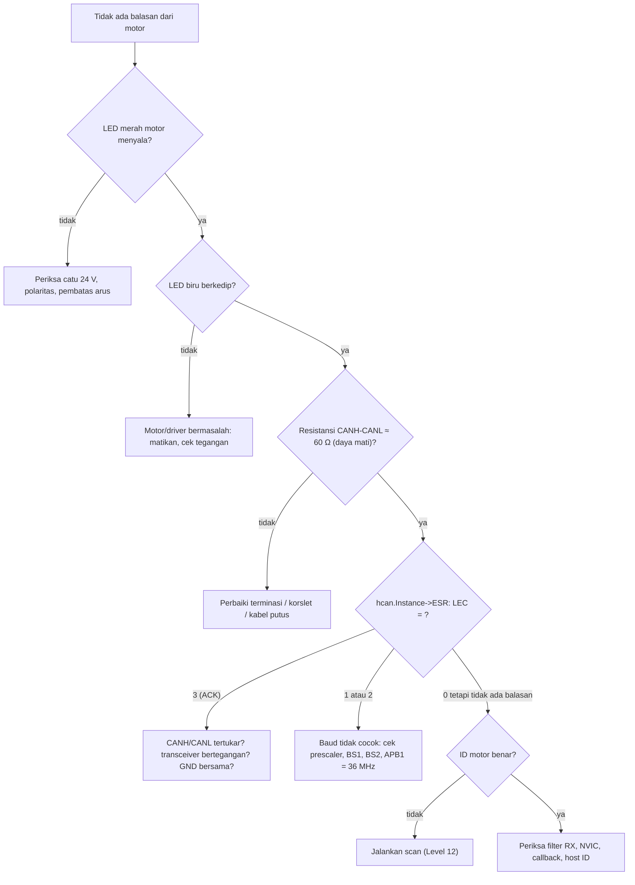

# Troubleshooting P5

[← Beranda](../README.md)

Aturan pakai: cari gejala, jalankan pemeriksaan **berurutan**, dan **berhenti di langkah pertama yang gagal**.

## 1. Motor tidak merespons

## 2. Gejala dan penyebab

| Gejala | Penyebab paling mungkin |
|---|---|
| `HAL_CAN_AddTxMessage` mengembalikan error | 3 mailbox penuh; belum ada ACK; `HAL_CAN_Start` belum dipanggil |
| TEC naik terus, LEC = 3 | tidak ada node yang mengakui (motor mati, kabel, baud) |
| `BOFF = 1` | bus-off; `AutoBusOff` mati; perlu pemulihan manual |
| Frame terkirim tapi motor tidak bergerak | motor belum di-enable; Kp = Kd = torsi = 0; urutan mode salah |
| Parameter "tidak berefek" | urutan byte index/nilai (harus LE) |
| Suhu 3 atau 35 bukan 35,5 | pembagian integer; harus `/ 10.0f` |
| Posisi selisih ±0,5% | rentang ±12,5 (contoh manual) vs ±4π (tabel) |
| Balasan Device ID tidak terbaca | pemeriksaan host di awal handler membuangnya |
| Scan tidak berhenti | penghitung loop `uint8_t` dengan batas 255 |
| Dua motor saling mengganggu | ID sama, terminasi salah |
| Callback RX tak terpanggil | NVIC CAN RX0 mati; `ActivateNotification` belum dipanggil; filter mati |

## 3. Build dan link

| Pesan | Penyebab |
|---|---|
| `undefined reference to 'cybergear_set_zero'` | fungsi dideklarasikan tetapi tidak didefinisikan (ada di library awal) |
| `undefined reference` pada fungsi C dari file C++ | header C belum dibungkus `extern "C"` |
| `multiple definition of 'USB_LP_CAN1_RX0_IRQHandler'` | ISR ganda: HAL dan milikmu (baremetal) |
| `multiple definition` variabel | variabel didefinisikan di `.h` (seharusnya `extern` + satu definisi di `.c`) |
| `unknown type name 'bool'` | lupa `#include <stdbool.h>` |
| `warning: this 'if' clause does not guard` | indentasi menyesatkan; beri kurung kurawal |

## 4. Uji di laptop (`make test-XX`)

| Gejala | Tindakan |
|---|---|
| `make: gcc: command not found` | `sudo apt install build-essential` |
| Level 7/10/12/14 gagal link | belum selesai Level 2/3/4 (dipakai ulang) atau nama file diubah |
| Tes "crash (segfault)" | dereference `NULL` (Level 5) atau indeks array di luar batas |
| Tes scan "tidak berakhir" | jebakan `uint8_t` pada batas 255 |
| `_Static_assert` gagal di Level 15 | struct register diubah; offset harus cocok dengan RM0008 |
| Awalnya semua `FAIL` | normal; kerangka sengaja kosong |

## 5. Kebiasaan debug yang menghemat waktu

- **Kecilkan masalahnya.** Uji satu fungsi sendirian (di laptop kalau bisa).
- **Tulis prediksi** sebelum menjalankan.
- **Pantau variabel** dengan Live Expressions: `rx_count`, `last_id`, `hcan.Instance->ESR`, struct motor.
- **Loopback** untuk memisahkan "kode salah" dari "kabel/motor salah".
- **Commit versi yang jalan**, supaya bisa kembali.
